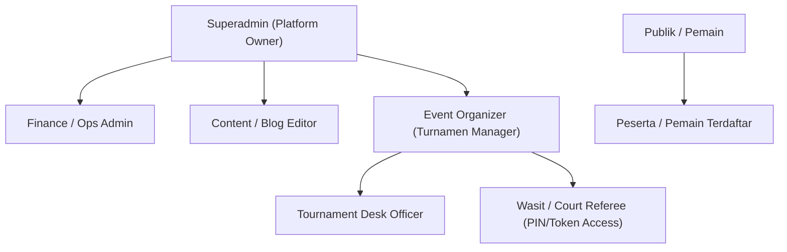
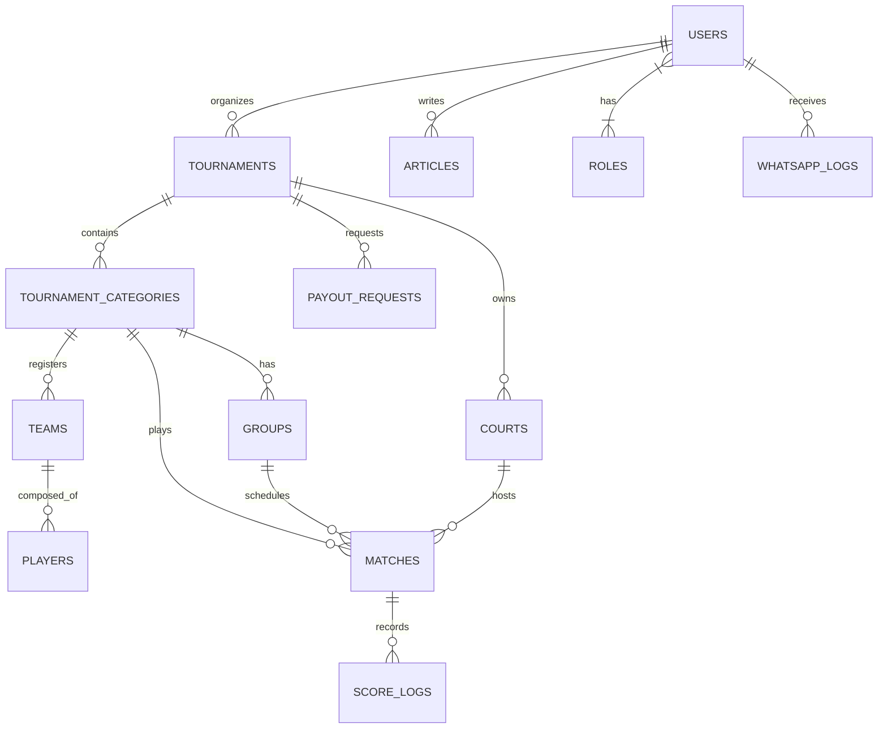

# BUSINESS REQUIREMENTS DOCUMENT (BRD) & SYSTEM ARCHITECTURE
## PadelGigs Core Tournament & Event Organizer (EO) Platform + Superadmin System
**Version:** 1.0.0  
**Target URL Reference:** [stage.padelgigs.id](https://stage.padelgigs.id)  
**Tech Stack:** **Laravel 13** (PHP 8.4+), **Inertia.js v2**, **React 19** (TypeScript), **Tailwind CSS v4**, **Vite 6**  
**Date:** Oktober 2026  
**Status:** Approved for Implementation  

---

## 1. PENDAHULUAN & RINGKASAN EKSEKUTIF

### 1.1 Latar Belakang
PadelGigs adalah platform manajemen turnamen olahraga raket (khususnya Padel & Tennis) terpadu. Sistem ini dirancang untuk mendigitalkan seluruh siklus penyelenggaraan turnamen mulai dari portal publik untuk penonton dan pemain, registrasi tim & pembayaran, pembagian bagan/bracket (Knockout & Round Robin), penjadwalan lapangan interaktif, hingga live tournament desk scoring dan pelaporan keuangan.

### 1.2 Tujuan Dokumen
Dokumen ini mendefinisikan kebutuhan fungsional dan teknis secara menyeluruh untuk:
1. **Portal Publik Spectator & Players**: Landing page, direktori turnamen, 6-tab public tournament viewer (`Live Score`, `Order of Play`, `Results`, `Leaderboard`, `Bracket`, `Slideshow TV Mode`), dan global player rankings.
2. **Kloning & Penyempurnaan Dashboard EO (Event Organizer)** sesuai arsitektur `stage.padelgigs.id`.
3. **Pengembangan Sistem Inti / Superadmin Total** dengan Role-Based Access Control (RBAC) granular.
4. **Integrasi WhatsApp Gateway sidobe.com** untuk automasi notifikasi real-time (pendaftaran, panggilan lapangan, skor, OTP).
5. **CMS / Blog Engine Lengkap** untuk manajemen konten, SEO, dan publikasi artikel publik.
6. **Tournament Match Engine**: Algoritma pembuatan grup, klasemen otomatis, bagan sistem gugur (Knockout), dan live score control.

---

## 2. ARSITEKTUR TEKNOLOGI & DAFTAR LENGKAP PUSTAKA (LIBRARIES)

### 2.1 Pustaka Backend Laravel (Composer Dependencies)

| Kategori / Modul | Paket (Composer Package) | Versi Target | Alasan & Rincian Penggunaan |
| :--- | :--- | :--- | :--- |
| **Data Wilayah Indonesia** | `laravolt/indonesia` | `^0.35` | **Data Resmi Kemendagri BPS** untuk 38 Provinsi, 514 Kota/Kabupaten, ribuan Kecamatan & Kelurahan. Berjalan offline di SQLite & MySQL tanpa ketergantungan API luar yang berisiko limit/down. Digunakan pada form registrasi atlet, profil user, dan lokasi venue turnamen EO. Dilengkapi endpoint internal ber-cache: `/api/provinces` & `/api/provinces/{id}/cities`. |
| **Otorisasi & RBAC** | `spatie/laravel-permission` | `^6.0` | Manajemen peran & izin terpadu (Superadmin, EO, Wasit Lapangan, Pemain, Blog Editor). |
| **Sanitasi Konten & Anti-XSS** | `mews/purifier` | `^3.4` | Integrasi resmi **HTMLPurifier** untuk mensterilkan output HTML dari TipTap Editor (Blog & Panduan Turnamen) dari script jahat / XSS payload. |
| **Pembuat QR Code Dinamis** | `simplesoftwareio/simple-qrcode` | `^4.2` | Menghasilkan QR Code SVG instan tanpa koneksi internet luar untuk URL wasit token (`/referee/{token}`), tiket pendaftaran tim, dan QR display live score kiosk. |
| **Ekspor Dokumen & Bagan** | `barryvdh/laravel-dompdf` | `^3.0` | Pembuatan file PDF unduhan: Jadwal resmi pertandingan, lembar bagan turnamen, invoice pendaftaran, dan sertifikat pemenang. |
| **Optimasi Multi-Gambar** | `intervention/image` | `^3.0` | Manipulasi gambar, auto-resize poster arena, kompresi format modern WebP, dan pembuatan thumbnail galeri foto turnamen. |
| **TypeScript Inertia Helper** | `tightenco/ziggy` | `^2.0` | Menyediakan helper fungsi `route('name', params)` bawaan Laravel yang dapat dipanggil langsung dari TypeScript / React 19. |
| **Realtime WebSockets** | `laravel/reverb` | `^1.0` | Server WebSocket native Laravel berkecepatan tinggi untuk live score update dan sinkronisasi skor wasit ke layar penonton secara instan. |
| **Queue & Cache Driver** | `predis/predis` | `^2.2` | Driver Redis berkecepatan tinggi untuk background job WhatsApp sidobe.com, perhitungan tie-breaker, dan cache tags master data. |

---

### 2.2 Pustaka Frontend JavaScript / React 19 (NPM Dependencies)

| Kategori / Modul | Pustaka (NPM Package) | Versi Target | Alasan & Rincian Penggunaan |
| :--- | :--- | :--- | :--- |
| **Rich Text Editor (CMS & Rules)** | `@tiptap/react` `@tiptap/starter-kit` `@tiptap/extension-image` `@tiptap/extension-link` `@tiptap/extension-placeholder` `@tiptap/extension-youtube` | `^2.11` | **Headless Rich Text Editor** standar industri modern. Digunakan untuk Blog CMS, Panduan Pendaftaran Turnamen, dan Aturan Khusus Kategori. Ringan, bebas bug styling bawaan, dan output HTML bersih tersanitasi. |
| **Unified Animation Engine (UI, Gesture, SVG)** | `motion` (`motion/react`) | `^12.0` | **Engine Animasi Terpadu (WAAPI + GPU Accelerated)**: Menyatukan transisi UI (`AnimatePresence`), transisi tab (`layoutId`), modal spring, dan animasi jalur SVG dinamis (`pathLength` glow beam pada Knockout Bracket) dalam satu ekosistem deklaratif bebas memory leak dan berkinerja 120 FPS. |
| **Micro-Animations & Stadium Radar (Zero JS)** | `Tailwind CSS v4 GPU Keyframes` | Native | **Animasi Tanpa Beban Runtime JS (0 KB)**: Rotasi kontinu 360° radar stadion, efek pulsing beacon lapangan aktif, dan skeleton shimmer diproses 100% pada Compositor Thread GPU browser. |
| **Selebrasi Juara (Visual Wow)** | `canvas-confetti` `@types/canvas-confetti` | `^1.9` | Efek ledakan konfeti partikel visual saat tim dinyatakan sebagai Juara 1 turnamen atau saat pendaftaran berhasil diselesaikan. |
| **Ikonografi Vektor Dinamis** | `lucide-react` | `^0.475` | 100% Vector icons dinamis dengan variasi stroke & ukuran (Menjamin standar **Zero Emoji Policy** di seluruh sistem). |
| **Mobile Drawer / Bottom Sheet** | `vaul` | `^1.1` | Komponen drawer bawah bergaya iOS native yang bisa di-swipe dengan gesture sentuh lembut untuk pengalaman mobile app pada filter, registrasi, dan input wasit. |
| **Multi-Image Carousel / Swiper** | `embla-carousel-react` | `^8.5` | Carousel sentuh (touch swipeable) ultra-ringan tanpa dependensi berat untuk galeri multi-foto turnamen. |
| **Fullscreen Image Lightbox** | `yet-another-react-lightbox` | `^3.21` | Lightbox galeri foto layar penuh dengan pinch-to-zoom, thumbnail strip, dan tombol keyboard navigation. |
| **Drag & Drop Reorder** | `@hello-pangea/dnd` | `^18.0` | Library Drag and Drop modern berbasis TypeScript yang sepenuhnya kompatibel dengan React 19 untuk penyusunan slot jadwal lapangan dan urutan master data. |
| **Notifikasi Toast Modern** | `sonner` | `^2.0` | Sistem notifikasi toast floating dengan efek glassmorphism, swipe-to-dismiss, dan auto-timeout. |
| **Grafik & Data Visualization** | `recharts` | `^2.15` | Rendering grafik radar polygon 5 dimensi kemampuan pemain dan grafik kurva garis tren performa bulanan atlet. |

---

## 3. ROLE-BASED ACCESS CONTROL (RBAC) & OTORISASI

Sistem menggunakan granular permissions berbasis Spatie Laravel-Permission.



### 3.1 Matriks Peran & Hak Akses (Permission Matrix)

| Modul / Fitur | Superadmin | EO (Organizer) | Tournament Desk | Wasit / Lapangan | Peserta (Pemain) | Blog Editor |
| :--- | :---: | :---: | :---: | :---: | :---: | :---: |
| **Kelola Role & User RBAC** | Full Access | No | No | No | No | No |
| **Konfigurasi WA sidobe.com**| Full Access | No | No | No | No | No |
| **Kelola Blog & Artikel** | Full Access | No | No | No | No | Full Access |
| **Approval Payout / Komisi** | Full Access | View Rekening | No | No | No | No |
| **Buat & Edit Turnamen** | Full Access | Milik Sendiri | No | No | No | No |
| **Konfigurasi Aturan Kategori**| Full Access | Milik Sendiri | No | No | No | No |
| **Verifikasi Pendaftaran & Bayar**| Full Access | Milik Sendiri | View | No | No | No |
| **Jadwal Lapangan (Drag & Drop)**| Full Access | Milik Sendiri | Yes | No | No | No |
| **Live Court Control & Match Queue**| Full Access | Milik Sendiri | Full Access | No | No | No |
| **Input Skor Lapangan** | Full Access | Milik Sendiri | Yes | Via Token/QR | No | No |
| **Check-in Pemain & QR Scan** | Full Access | Milik Sendiri | Yes | No | Self View | No |
| **Cetak Bagan & Score Sheet** | Full Access | Milik Sendiri | Yes | No | View Only | No |

---

## 4. DASHBOARD EVENT ORGANIZER (EO) - SPESIFIKASI FITUR INTI

Sesuai hasil audit menyeluruh pada `stage.padelgigs.id`, berikut alur kerja dan fitur inti dashboard EO:

### 4.1 Dashboard Utama (`/dashboard`)
* **Metric Cards**:
  * `Total Turnamen`: Agregat status (Draft, Live/Publish, Selesai).
  * `Sedang Berlangsung`: Jumlah turnamen aktif hari ini.
  * `Total Pendaftar`: Jumlah registrasi tim terverifikasi.
  * `Total Tim`: Total pasangan tim di seluruh turnamen.
* **Turnamen Terbaru Card**: Quick-action preview dengan status pill (`Draft`, `Live`), tombol aksi cepat (*Kelola Turnamen*, *Tournament Desk*).
* **Banner Selamat Datang**: Notifikasi onboarding profil dan tombol pintas pembuatan turnamen baru.

### 4.2 Manajemen Turnamen (`/organizer/tournaments`)
* **List Turnamen Saya**:
  * Tabel: Poster, Nama Turnamen, Lokasi, Rentang Tanggal, Status, Kuota Terisi, Aksi (Lihat, Edit, Hapus).
  * Filter: Pencarian nama, status turnamen (Draft, Published, Ongoing, Finished).
* **Pembuatan Turnamen Baru (`/organizer/tournaments/create`)**:
  * *Informasi Turnamen*: Unggah Multi-Gambar Media Turnamen (hingga 10 foto: Poster Utama, Arena Lapangan, Lounge Venue, Trophy Showcase, dan Sponsor Wall; foto urutan pertama otomatis menjadi Gambar Unggulan / Featured Image dengan opsi klik bintang untuk memilih featured), Nama turnamen, Kategori Olahraga (`Padel` / `Tennis`), Deskripsi lengkap (Rich text).
  * *Lokasi Turnamen*: Nama Venue, Alamat lengkap, Pilihan Provinsi & Kota/Kabupaten (Dropdown wilayah Indonesia).
  * *Jadwal*: Tanggal mulai & selesai.
  * *Registrasi Peserta*: Batas akhir pendaftaran, Panduan pendaftaran (Rich text), Akun Bank Penarikan (Nama Bank, Nomor Rekening, Nama Pemilik Rekening).
  * *Kategori Pertandingan (Dynamic Repeater)*:
    * Nama Kategori (misal: *Community • Men • Beginner*, *Community • Women • Rookie*).
    * Tier (`Mini`, `Grand`, `Open`, `Community`), Divisi (`Men`, `Women`, `Mixed`, `Open`), Level Skill (`Newbie`, `Rookie`, `Beginner`, `Upper Beginner`, `Intermediate`, `Lower Bronze`).
    * Status registrasi terbuka/tertutup.

### 4.3 Pusat Operasional Turnamen (`/organizer/tournaments/{id}`)
Halaman sentral pengelolaan saat turnamen telah dibuat:
* **Header Aksi**: Edit Detail Turnamen, Tombol `Publikasikan` / Unpublish.
* **Ringkasan Kategori**: Kartu untuk setiap kategori yang berisi kuota tim, format pertandingan (`Grup + Knockout`), status kelengkapan konfigurasi, dan tombol `Kelola`.
* **Navigasi Operasional 7 Menu Inti**:
  1. `Download QR Turnamen`: Menghasilkan QR Code resmi turnamen untuk scan info publik & live bracket.
  2. `Registrasi Peserta`: Hub manajemen verifikasi tim.
  3. `Form Pendaftaran`: Kustomisasi form pendaftaran tambahan (ukuran jersey, kontak darurat, dll.).
  4. `Tournament Desk (Court Control)`: Live match manager per lapangan.
  5. `Check In Player`: Meja presensi fisik pemain di hari-H.
  6. `Jadwal Pertandingan`: Matriks visual jadwal lapangan vs waktu.
  7. `Kelola Lapangan`: Master data lapangan turnamen & PIN wasit.
  8. `Riwayat Cetak & Log Skor`: Audit log perubahan skor dan cetak match-sheet.

---

### 4.4 Rincian 7 Modul Operasional Turnamen

#### A. Konfigurasi Kategori & Match Engine (`.../items/{categoryId}/configure`)
Pusat pengaturan seluruh aspek kompetitif pertandingan, terbagi menjadi 6 sub-navigasi operasional:
1. **Sub-Tab Konfigurasi (`/configure`)**:
   * **Format Pertandingan**:
     * `Group + Knockout`: Fase grup setengah kompetisi dilanjutkan fase gugur dengan bagan eliminasi.
     * `Knockout Only`: Sistem gugur murni dari babak awal (R32, R16, QF, SF, Final).
     * `League / Round Robin`: Sistem liga kompetisi penuh tanpa babak eliminasi.
   * **Parameter Distribusi Grup**:
     * `Kuota Tim`: Total tim maksimal dalam kategori (misal: 12 tim).
     * `Jumlah Tim Per Grup`: Kapasitas anggota tiap grup (misal: 6 tim/grup).
     * `Tim Lolos Per Grup`: Jumlah tim yang berhak melaju ke babak knockout (misal: Top 3).
     * `Leg Pertandingan Grup`: Pilihan 1 Leg (Single round) atau 2 Legs (Home & Away).
     * `Jumlah Grup (Opsional)`: Kalkulasi otomatis $\lceil \text{Kuota} / \text{Tim per Grup} \rceil$ atau kustomisasi manual.
     * `Wildcard / Best Loser (Toggle)`: Mengizinkan tim ranking tertinggi non-lolos melaju untuk melengkapi bagan genap $2^n$.
     * `Perebutan Juara 3 / Bronze Match (Toggle)`: Pertandingan otomatis antara 2 tim yang kalah di Semifinal.
     * `Metode Knockout`:
       * `Knockout By Group`: Pemasangan bagan silang grup (Juara Grup A vs Posisi 3 Grup B).
       * `Knockout By Seeding`: Penentuan bagan berdasarkan ranking agregat seluruh grup.
   * **Aturan Pertandingan Per Babak (Independent Rules Engine)**:
     Dapat dikonfigurasi berbeda secara granular pada setiap babak (`Group Stage`, `Quarter Final`, `Semi Final`, `Final`):
     * `Format Game (Race To)`: Pilihan race to 3, 4, 6, 8, atau 9 games.
     * `Format Set`: 1 Pro-Set atau Best of 3 Sets.
     * `Deuce Rule`: *Golden Point* (40-40 sudden death, server menentukan sisi servis) atau *Advantage* (harus selisih 2 poin).
     * `Tie Break Rule`: Toggle aktif di 6-6 (poin 7 selisih 2) atau Super Tie Break (10 poin selisih 2 pengganti set 3).
2. **Sub-Tab Informasi Rules (`/rules`)**:
   * Editor teks panduan peraturan pertandingan turnamen.
   * Tombol *Generate Rules*: Generator otomatis aturan standar FIP / Padel Indonesia.
   * Upload lampiran file PDF Rulebook resmi hingga 10MB.
3. **Sub-Tab Pendaftaran Tim & Undian (`/teams`)**:
   * Indikator kuota terisi (misal: `11/12 Slot`).
   * Roster pasangan: Nama & Foto Pemain 1 dan Pemain 2, nomor telepon, dan status verifikasi.
   * Fitur **Mulai Undian Grup (Random Draw Engine)**: Algoritma Fisher-Yates + Bucket Balancing untuk mengacak penempatan grup tim non-unggulan secara merata dan transparan dengan animasi kartu.
4. **Sub-Tab Klasemen & Tie-Breaker Engine (`/groups`)**:
   * Tabel live: Peringkat, Tim, Main (P), Menang (W), Kalah (L), Game Menang (WP), Game Kalah (LP), Ratio, Win%.
   * **Hirarki Tie-Breaker Otomatis**:
     1. Head-to-Head (H2H) antar tim bersangkutan.
     2. Selisih Game (Game Difference: $\text{WP} - \text{LP}$).
     3. Total Game Menang (WP).
     4. Game Ratio ($\text{WP} / (\text{WP} + \text{LP})$).
     5. Undian Komite.
   * Tombol **Kunci & Loloskan Grup**: Membekukan klasemen, menentukan tim lolos, menghitung slot BYE, dan men-generate bagan knockout secara otomatis.
5. **Sub-Tab Pertandingan / Fixtures (`/matches`)**:
   * Penjadwalan Round-Robin otomatis menggunakan Algoritma Berger (Circle Method).
   * Alokasi ke lapangan (*Court Barat*, *Court Timur*) dan jam mulai pertandingan.
   * Status match reaktif: `PENDING`, `ON_COURT`, `COMPLETED`.
6. **Sub-Tab Bagan Knockout (`/bracket`)**:
   * Visualisasi pohon biner eliminasi (Quarter Final, Semifinal, Final, dan Perebutan Juara 3).
   * Otomasi slot BYE untuk juara grup jika kuota knockout ganjil (contoh 6 tim lolos: Juara Grup A & B langsung BYE ke Semifinal, sedangkan Posisi 2 & 3 bertanding di QF).
   * Integrasi auto-advance pemenang ke `next_match_id` saat skor match dinyatakan selesai.

#### B. Tournament Desk / Court Control (`.../court-control`)
* **Monitor Lapangan Real-Time**:
  * Grid kartu per lapangan (misal *Padelibre Court Barat*, *Padelibre Court Timur*).
  * Status: `Kosong`, `Pemanasan (Warm-up)`, `Sedang Berlangsung`, `Selesai`.
  * Menampilkan: Tim 1 vs Tim 2, Babak, Skor Set/Game berjalan, Stopwatch Timer pertandingan.
  * Tombol Aksi Langsung: *Panggil Tim*, *Input Skor Langsung*, *Ganti Lapangan*, *Selesaikan Pertandingan*.
* **Antrian Pertandingan (Match Queue)**:
  * Daftar pertandingan berikutnya yang siap masuk ke lapangan yang segera kosong.
* **Daftar Pertandingan (Match List)**:
  * Pencarian match berdasarkan ID/nama pemain.
  * Filter kategori.
  * Toggle mode: `Live Score Mode` & `Input Masal (Bulk Entry)` untuk input cepat offline.

#### C. Penjadwalan Lapangan / Schedule Grid (`.../schedule`)
* **Interactive Time-Court Matrix**:
  * Sumbu X: Lapangan turnamen (Court 1, Court 2, dst.).
  * Sumbu Y: Slot waktu dengan interval dinamis (30 menit, 45 menit, 60 menit) mulai pk 08:00 s/d 22:00.
* **Sidebar Pertandingan Belum Dijadwalkan (`Belum Dijadwalkan`)**:
  * Daftar kartu match yang belum memiliki jam & lapangan.
  * Fitur Drag-and-Drop dari sidebar ke slot lapangan atau klik alokasikan.
* **Fitur Utility**:
  * Tab filter tanggal pertandingan.
  * `Kosongkan Jadwal` (Reset alokasi).
  * `Download Jadwal PDF/Excel` untuk dipajang di papan pengumuman.

#### D. Kelola Lapangan & Akses Wasit (`.../courts`)
* **Master Lapangan**: Tambah lapangan baru, edit nama lapangan, lokasi/orientasi.
* **Akses Wasit Terdesentralisasi (Referee Token System)**:
  * Sistem membuat PIN unik / Kode Akses wasit per lapangan.
  * Link khusus mobile wasit (misal: `/referee/court/{courtId}?token=XYZ123`).
  * QR Code wasit yang bisa dicetak dan ditempel di tiang wasit masing-masing lapangan. Wasit cukup scan QR dengan HP untuk mencatat skor poin demi poin tanpa harus login akun master.

#### E. Registrasi Peserta & Verifikasi (`.../registrations`)
* **Tab Filter Status**:
  * `Semua` | `Menunggu Konfirmasi` | `Paid` | `Perlu Refund` | `Refunded` | `Ditolak` | `Cancelled` | `Expired`.
* **Data Peserta**:
  * Nama Tim, Foto/Nama Pemain 1 & Kontak, Nama Pemain 2 & Kontak, Kategori yang dipilih, Total Biaya.
  * Bukti Transfer / Status Gateway, Waktu Daftar.
  * Aksi: *Approve Tim*, *Reject Tim* (dengan alasan penolakan via WA otomatis), *Refund*, *Ganti Kategori*.

#### F. Check-In Meja Registrasi (`.../check-in`)
* **Dashboard Presensi**:
  * Widget: Total Pemain, Hadir (Checked-in), Belum Hadir.
* **Daftar Presensi**:
  * Data terpisah per pemain: Nama, NIK, No. Telepon, Status Hadir (Toggle Switch).
  * Scanner QR untuk scan barcode tiket peserta di meja penerimaan tamu.
  * Tombol `Simpan Semua` untuk simpan batch presensi.

#### G. Riwayat Cetak & Log Skor (`.../score-logs`)
* **Audit Trail**:
  * Log setiap ada perubahan skor (Waktu, Diubah oleh siapa, Skor lama -> Skor baru).
  * Mencegah kecurangan atau kesalahan input wasit.
  * Fitur cetak lembar skor resmi (Official Match Sheet) bertanda tangan pemain.

---

### 4.5 Modul Portal Publik Spectator & Players (Hasil Reverse-Engineering)

Sesuai hasil audit live di `stage.padelgigs.id`, sistem publik memiliki struktur halaman khusus yang diakses oleh penonton, pemain, dan layar proyektor venue:

1. **Beranda & Landing Page (`/`)**:
   * Hero Banner: *"HOME OF PADEL PLAYERS & TOURNAMENTS"* & CTA *"Daftar sebagai Player"* (`/register/player`).
   * Widget `Live Score / Live Today`: Ticker real-time pertandingan yang sedang dan akan bertanding hari ini.
   * `Upcoming Tournaments`: Kartu turnamen terdekat dengan badge tanggal dan status pendaftaran.
   * `Winners of the Month`: Papan pemain dengan gelar turnamen terbanyak bulan ini.
   * Counter metrik live (1.023+ pemain aktif).
   * Floating WhatsApp button (`wa.me`) untuk kontak panitia langsung.
2. **Direktori Turnamen Publik (`/tournaments`)**:
   * Tab filter status: `UPCOMING` | `LIVE` | `SELESAI`.
   * Dropdown filter wilayah provinsi/kota (`Semua Wilayah`).
   * Pencarian instan judul turnamen.
3. **Pusat Informasi & Live View Turnamen Publik (`/tournaments/{id}`)**:
   * Header: Banner poster resmi dengan efek blur backdrop, **Galeri Foto Multi-Gambar Turnamen** (Carousel swipeable & Fullscreen Lightbox dengan thumbnail preview untuk foto venue, piala, dan sponsor), tanggal turnamen, alamat venue Google Maps, dan nama EO.
   * **6 Tab Publik Utama Secara Total**:
     * *(Logika Dinamis: Tab LIVE SCORE hanya dirender jika terdapat minimal 1 match berstatus ON COURT. Jika seluruh match masih berstatus PENDING seperti pada Focus Turnamen, tab LIVE SCORE disembunyikan dan sistem secara default membuka tab ORDER OF PLAY).*
     * **`LIVE SCORE`**: Menampilkan kartu match lapangan yang sedang aktif (`ON COURT`). Dilengkapi badge nomor lapangan (Lapangan 1, 2, dst.), babak/grup (`Bronze Men | Grup B`), aturan (`1SET · FIRST6 · GP`), live score game berjalan, dan tombol `See Match Detail`.
     * **`ORDER OF PLAY` (Jadwal)**: Jadwal seluruh pertandingan (tercatat 114 matches pada Focus Turnamen, 138 pada Inpedia) dengan filter 4 sumbu: *Sort Order (Terlama/Terbaru Terjadwal)*, *Filter Babak*, *Filter Kategori*, dan *Pencarian Nama Pemain*.
     * **`RESULTS`**: Arsip pertandingan selesai dengan penanda tim pemenang bertanda ikon vektor `<CheckCircle2 />` hijau, rekap skor per set, dan pengurutan *Terbaru Selesai*. Jika belum ada match selesai, menampilkan empty state *"Belum Ada Hasil Pertandingan"*.
     * **`LEADERBOARD` (Klasemen Grup)**: Klasemen grup publik dengan toggle `Per Grup` vs `Lintas Grup`, tab kategori, dan kolom statistik lengkap (Pos, Team, P, W, L, WP, LP, Ratio, Win%) disertai penanda zona hijau tim lolos.
     * **`BRACKET` (Bagan Gugur)**: Bagan visual interaktif babak eliminasi dengan penempatan dinamis pemenang grup (`Winner Group A/B/C/D`, `TBD`), skor simpul, dan tombol `Unduh Gambar` resolusi tinggi.
     * **`SLIDESHOW` (TV Venue Display)**: Mode Kiosk Layar Penuh (*Fullscreen*) tanpa navbar khusus untuk TV/proyektor spectator lounge venue, berputar otomatis menampilkan Live Score, Jadwal Berikutnya, Klasemen Terkini, dan Bagan dengan QR Code turnamen resmi.
4. **Peringkat Pemain Global & Profil Single Player (`/leaderboard` & `/leaderboard/{uuid}`)**:
   * **Profil Single Player**:
     * Header: Foto profil avatar dan nama lengkap pemain (contoh: *Jason Sugihan P.*).
     * 4 Kartu Metrik: `MAIN` (Total pertandingan), `MENANG` (Total menang), `WIN RATE` (Persentase menang %), dan `JUARA` (Total gelar turnamen/piala).
     * Grafik Tahunan ("Statistik per tahun"): Filter tahun (2026), grafik lingkaran persentase, dan *Interactive Line Chart Tren Performa* bulanan (Januari–Desember) membandingkan kurva menang dan kalah.
     * Riwayat Turnamen ("Riwayat Turnamen"): Tab toggle *Public* vs *Community*, daftar kartu turnamen yang pernah diikuti dengan badge pencapaian babak (*GROUP STAGE*, *QUARTER FINALS*, *SEMI FINALS*, *WINNER*).
   * **Hall of Fame Juara (`/winners`)**: Daftar juara 1, 2, dan 3 dari setiap edisi turnamen.
5. **Alur Registrasi Akun Pemain (`/register` & `/register/player`)**:
   * Pendaftaran akun dengan form data pemain: Nama Lengkap, Nomor HP/WhatsApp, Email, Password, Gender, Tingkat Kemahiran/Skill Tier (*Beginner*, *Intermediate*, *Advanced*, *Pro*), Sisi Bermain Favorit (*Left/Right*), Tangan Dominan (*Right/Left*), dan Kota Domisili.
   * Pemain otomatis terafiliasi dengan peringkat nasional (Leaderboard) sejak match pertama.
6. **Alur Pendaftaran Turnamen Publik (Tournament Registration Wizard)**:
   * **Langkah 1**: Pemilihan Kategori kompetisi dengan info biaya dan sisa kuota tim.
   * **Langkah 2**: Input Nama Tim dan data Kapten (Player 1) yang otomatis terisi dari akun login.
   * **Langkah 3**: Integrasi Partner (Player 2) via pencarian database atau input manual tamu.
   * **Langkah 4**: Kuesioner Turnamen (Ukuran jersey S–XXL, NIK KTP, Kontak Darurat).
   * **Langkah 5**: Pembayaran & Verifikasi (Transfer Bank manual EO, QRIS, Virtual Account + upload bukti transfer).
   * **Langkah 6**: Konfirmasi sukses & trigger otomatis notifikasi WhatsApp sidobe.com ke nomor kedua pemain.
7. **Arsitektur Antarmuka Mobile App-First (PWA Standard)**:
   * **Bilah Navigasi Bawah Tetap (`<MobileBottomNav />`)**: Fixed bottom navigation bar pada viewport mobile (< 768px) dengan dukungan `env(safe-area-inset-bottom)` untuk gesture bar iOS/Android.
   * 5 Item Navigasi Utama: `Home` (`<Home />`), `Turnamen` (`<Trophy />`), `Live` (`<Radio />` dengan indikator pulsing dot aktif), `Ranking` (`<BarChart3 />`), dan `Profil / EO Desk` (`<User />` / `<LayoutDashboard />`).
   * **Mobile Bottom Sheet Drawers**: Form filter, pendaftaran, dan input skor wasit menggunakan sheet geser dari bawah (*Swipe to dismiss*) alih-alih modal popup desktop.
   * **Ergonomi Sentuh Lapangan**: Ukuran tombol minimal 48px dan dukungan pull-to-refresh untuk update live score.

---

## 5. ARSITEKTUR SUPERADMIN (SISTEM INTI PLATFORM)

Superadmin memiliki kontrol menyeluruh atas seluruh ekosistem PadelGigs.

### 5.1 Superadmin Dashboard
* Ringkasan platform: Total Omset (GMV), Total Event Organizer aktif, Total Turnamen terdaftar, Total Match yang telah berlangsung di seluruh Indonesia, Total pesan WhatsApp terkirim via sidobe.com.
* System Health Monitor: Status antrian background worker Redis/Horizon, status koneksi WhatsApp sidobe.com, error logs.

### 5.2 Manajemen RBAC & User
* **User Management**: Listing seluruh user dengan filter role (Superadmin, EO, Wasit, Pemain, Blog Editor).
* **Role & Permission Editor**:
  * Buat role kustom.
  * Checklist granular permissions (baca, buat, edit, hapus) per modul.
* **Impersonation Mode**: Kemampuan Superadmin untuk login sementara sebagai EO tertentu guna membantu troubleshooting turnamen tanpa perlu mengetahui password EO.

### 5.3 Integrasi WhatsApp Gateway (sidobe.com)

Modul ini bertanggung jawab penuh atas otomasi komunikasi WhatsApp keluar (outbound) dan penerimaan webhook status pengiriman:

#### Konfigurasi Gateway sidobe.com (`/admin/settings/whatsapp`)
* **Kredensial API**:
  * `API Base URL`: URL endpoint sidobe.com (misal: `https://api.sidobe.com/v1` atau sesuai dokumentasi sidobe).
  * `API Key / Secret Token`: Token autentikasi Bearer/Header.
  * `Sender Device ID / Session ID`: ID nomor pengirim yang terhubung.
  * `Webhook Secret Key`: Validasi payload masuk.
* **Fitur Uji Koneksi**:
  * Tombol `Cek Status Koneksi / Session Status`.
  * Tombol `Kirim Pesan Uji Coba` ke nomor admin.
* **Template Pesan WhatsApp Dinamis**:
  Dukungan variabel dinamis: `{nama_pemain}`, `{nama_turnamen}`, `{kategori}`, `{jadwal_main}`, `{lapangan}`, `{skor_akhir}`, `{link_bracket}`.
  1. *Template Pendaftaran Berhasil*: Instruksi pembayaran / tiket turnamen.
  2. *Template Verifikasi Tim*: Notifikasi tim disetujui & masuk bagan.
  3. *Template Panggilan Lapangan (Court Call)*: Memberitahu pemain: *"Pertandingan Anda di Lapangan 2 akan dimulai dalam 10 menit. Harap segera menuju Tournament Desk"*.
  4. *Template Hasil Pertandingan*: Update skor instan setelah match selesai.
  5. *Template Reset Password / OTP*.
* **WhatsApp Message Log & Monitor**:
  * Log setiap pesan: Nomor Tujuan, Tipe Event, Konten Pesan, Status (`Queued`, `Sent`, `Delivered`, `Failed`), Retry count, Pesan error jika gagal.

### 5.4 CMS & Manajemen Blog (`/admin/blog`)
* **Manajemen Artikel**:
  * Judul, Slug otomatis ramah SEO, Ringkasan (Excerpt).
  * Konten dengan Rich Text Editor (mendukung upload gambar, heading, embed video).
  * Featured Image (Thumbnail).
  * Kategori Blog (misal: *Tips & Trik Padel*, *Turnamen*, *Berita Komunitas*, *Review Raket*).
  * Tagar (Tags).
  * Status: `Draft`, `Published`, `Scheduled`.
  * SEO Meta: Meta Title, Meta Description, OpenGraph Image preview.
* **Kategori & Tag Manager**: CRUD kategori dan tag blog.

### 5.5 Master Data Dinamis & Finansial (Superadmin Control Center)
Superadmin memiliki kontrol penuh untuk menambah, mengedit, mengaktifkan/menonaktifkan, dan menghapus seluruh master data pertandingan tanpa perlu mengubah kode:

* **Modul Master Tier (`/admin/master/tiers`)**:
  * Fitur: Tambah Tier Baru, Edit Nama & Deskripsi, Re-order urutan, Toggle status `is_active`, Hapus (Soft Delete).
  * Data Bawaan (Default Seeded): `Mini`, `Grand`, `Open`, `Community`.
  * Fleksibilitas: Superadmin dapat menambahkan tier baru (contoh: *Major*, *Challenger*, *Corporate Cup*).
* **Modul Master Divisi (`/admin/master/divisions`)**:
  * Fitur: Tambah Divisi Baru, Edit Nama, Re-order urutan, Toggle status `is_active`, Hapus (Soft Delete).
  * Data Bawaan (Default Seeded): `Men`, `Women`, `Mixed`, `Open`.
  * Fleksibilitas: Superadmin dapat menambahkan divisi baru (contoh: *Junior U-16*, *Veterans 45+*, *Corporate Mixed*).
* **Modul Master Level Skill (`/admin/master/skill-levels`)**:
  * Fitur: Tambah Skill Level Baru, Edit Nama & Rentang Rating, Re-order urutan, Toggle status `is_active`, Hapus (Soft Delete).
  * Data Bawaan (Default Seeded): `Newbie`, `Rookie`, `Beginner`, `Upper Beginner`, `Intermediate`, `Lower Bronze`.
  * Fleksibilitas: Superadmin dapat menambah level baru (contoh: *Upper Bronze*, *Silver*, *Gold*, *Professional*).
* **Mekanisme Perlindungan Data Historis (Data Integrity & Snapshot)**:
  * Menggunakan `SoftDeletes` dan pencatatan snapshot string pada kategori turnamen. Jika Superadmin menonaktifkan atau menghapus tier/divisi tertentu, turnamen terdahulu yang pernah menggunakan tier/divisi tersebut tetap aman dan tidak rusak.
  * Form pembuatan turnamen EO (`/organizer/tournaments/create`) secara otomatis mengambil data aktif (`is_active = true`) dari Redis Cache yang ter-update instan via Model Observers.
* **Master Wilayah Indonesia**: Provinsi dan Kota/Kabupaten untuk filter direktori turnamen.
* **Manajemen Payout & Keuangan**:
  * Daftar permintaan pencairan dana (Withdrawal) dari EO.
  * Potongan platform fee / komisi per transaksi pendaftaran.
  * Approval / Reject pencairan dana beserta bukti transfer bank.

---

## 6. PERANCANGAN DATABASE (DATA MODEL & SCHEMA)



### 6.1 Tabel Utama & Kamus Data Terverifikasi (Zero-Omission DDL)

#### `users`
* `id`: UUID (Primary Key)
* `name`: VARCHAR(255)
* `email`: VARCHAR(255) (Unique)
* `phone`: VARCHAR(30) (Unique, format internasional 62xxx untuk WA)
* `password`: VARCHAR(255)
* `avatar_url`: VARCHAR(255), Nullable
* `role`: VARCHAR(50) (Superadmin, Organizer, Player, Referee)
* `gender`: ENUM('male', 'female'), Nullable
* `skill_level`: ENUM('Newbie', 'Rookie', 'Beginner', 'Upper Beginner', 'Intermediate', 'Lower Bronze'), Nullable
* `preferred_side`: ENUM('left', 'right'), Nullable
* `dominant_hand`: ENUM('right', 'left'), Nullable
* `province_id`: VARCHAR(10), Nullable
* `city_id`: VARCHAR(10), Nullable
* `created_at`, `updated_at`: TIMESTAMP

#### `tournaments`
* `id`: UUID (Primary Key)
* `user_id`: UUID (Foreign Key -> users.id, Penyelenggara/EO)
* `name`: VARCHAR(255)
* `slug`: VARCHAR(255) (Unique)
* `sport_type`: ENUM('padel', 'tennis')
* `description`: TEXT
* `poster_path`: VARCHAR(255)
* `venue_name`: VARCHAR(255)
* `venue_address`: TEXT
* `province_id`: VARCHAR(10)
* `city_id`: VARCHAR(10)
* `start_date`: DATE
* `end_date`: DATE
* `registration_deadline`: DATETIME
* `registration_guide`: TEXT
* `bank_name`: VARCHAR(100)
* `bank_account_number`: VARCHAR(100)
* `bank_account_holder`: VARCHAR(255)
* `status`: ENUM('draft', 'published', 'ongoing', 'completed', 'cancelled')
* `created_at`, `updated_at`: TIMESTAMP

#### `master_tiers`, `master_divisions`, `master_skill_levels` (Master Data Dinamis Superadmin)
* `master_tiers`:
  * `id`: UUID (Primary Key)
  * `name`: VARCHAR(100) (e.g. 'Mini', 'Grand', 'Open', 'Community')
  * `slug`: VARCHAR(100) (Unique)
  * `description`: TEXT, Nullable
  * `sort_order`: INT (Default 0)
  * `is_active`: BOOLEAN (Default true)
  * `deleted_at`: TIMESTAMP, Nullable (SoftDeletes)
  * `created_at`, `updated_at`: TIMESTAMP
* `master_divisions`:
  * `id`: UUID (Primary Key)
  * `name`: VARCHAR(100) (e.g. 'Men', 'Women', 'Mixed', 'Open')
  * `slug`: VARCHAR(100) (Unique)
  * `sort_order`: INT (Default 0)
  * `is_active`: BOOLEAN (Default true)
  * `deleted_at`: TIMESTAMP, Nullable (SoftDeletes)
  * `created_at`, `updated_at`: TIMESTAMP
* `master_skill_levels`:
  * `id`: UUID (Primary Key)
  * `name`: VARCHAR(100) (e.g. 'Newbie', 'Rookie', 'Beginner', 'Upper Beginner', 'Intermediate', 'Lower Bronze')
  * `slug`: VARCHAR(100) (Unique)
  * `min_rating`: INT, Nullable
  * `max_rating`: INT, Nullable
  * `sort_order`: INT (Default 0)
  * `is_active`: BOOLEAN (Default true)
  * `deleted_at`: TIMESTAMP, Nullable (SoftDeletes)
  * `created_at`, `updated_at`: TIMESTAMP

#### `tournament_categories`
* `id`: UUID (Primary Key)
* `tournament_id`: UUID (Foreign Key -> tournaments.id)
* `name`: VARCHAR(255) (contoh: Men Beginner, Bronze Women)
* `tier_id`: UUID Nullable (Foreign Key -> master_tiers.id)
* `tier_name`: VARCHAR(100) (Snapshot name agar turnamen lama tidak rusak jika master diubah)
* `division_id`: UUID Nullable (Foreign Key -> master_divisions.id)
* `division_name`: VARCHAR(100) (Snapshot name)
* `skill_level_id`: UUID Nullable (Foreign Key -> master_skill_levels.id)
* `skill_level_name`: VARCHAR(100) (Snapshot name)
* `max_teams`: INT (Kuota maksimal, e.g. 12)
* `registration_fee`: DECIMAL(12, 2)
* `format`: ENUM('group_knockout', 'knockout_only', 'round_robin')
* `group_count`: INT (Jumlah grup)
* `advancing_per_group`: INT
* `has_wildcard`: BOOLEAN (Best Loser option)
* `has_third_place`: BOOLEAN (Perebutan Juara 3)
* `knockout_method`: ENUM('cross_group', 'seeded_draw')
* `match_rules`: JSON (Race to 3/4/6/8/9, Deuce Golden Point/Advantage, Tie Break 7pt, Super Tie Break 10pt per babak)
* `is_open_registration`: BOOLEAN
* `created_at`, `updated_at`: TIMESTAMP

#### `courts`
* `id`: UUID (Primary Key)
* `tournament_id`: UUID (Foreign Key -> tournaments.id)
* `name`: VARCHAR(100) (contoh: Lapangan 1, Padelibre Court Barat)
* `referee_token`: VARCHAR(64) (Token rahasia akses wasit tanpa login, e.g. Z3QQ-WRK6)
* `referee_pin`: VARCHAR(10)
* `is_active`: BOOLEAN
* `created_at`, `updated_at`: TIMESTAMP

#### `teams`
* `id`: UUID (Primary Key)
* `category_id`: UUID (Foreign Key -> tournament_categories.id)
* `group_name`: VARCHAR(10), Nullable ('A', 'B', 'C', 'D')
* `team_name`: VARCHAR(255)
* `payment_status`: ENUM('pending', 'paid', 'refund_needed', 'refunded', 'rejected', 'expired')
* `payment_proof_path`: VARCHAR(255), Nullable
* `total_amount`: DECIMAL(12, 2)
* `is_checked_in`: BOOLEAN (Presensi meja registrasi)
* `seeding_number`: INT, Nullable
* `created_at`, `updated_at`: TIMESTAMP

#### `team_players`
* `id`: UUID (Primary Key)
* `team_id`: UUID (Foreign Key -> teams.id)
* `user_id`: UUID Nullable (Foreign Key -> users.id jika sudah punya akun)
* `is_captain`: BOOLEAN (Player 1 = true, Player 2 = false)
* `full_name`: VARCHAR(255)
* `email`: VARCHAR(255)
* `phone`: VARCHAR(30)
* `nik`: VARCHAR(30), Nullable (KTP untuk asuransi/verifikasi)
* `jersey_size`: ENUM('S', 'M', 'L', 'XL', 'XXL'), Nullable
* `emergency_contact_name`: VARCHAR(255), Nullable
* `emergency_contact_phone`: VARCHAR(30), Nullable
* `is_checked_in`: BOOLEAN
* `created_at`, `updated_at`: TIMESTAMP

#### `matches`
* `id`: UUID (Primary Key)
* `category_id`: UUID (Foreign Key -> tournament_categories.id)
* `stage`: ENUM('group', 'round_of_32', 'round_of_16', 'quarter_final', 'semi_final', 'final', 'bronze_match')
* `group_name`: VARCHAR(10), Nullable
* `round_number`: INT (Putaran 1, 2, 3...)
* `match_order`: INT
* `court_id`: UUID Nullable (Foreign Key -> courts.id)
* `team_1_id`: UUID Nullable (Foreign Key -> teams.id)
* `team_2_id`: UUID Nullable (Foreign Key -> teams.id)
* `scheduled_time`: DATETIME Nullable
* `status`: ENUM('pending', 'scheduled', 'court_assigned', 'warming_up', 'in_progress', 'completed', 'walkover')
* `score_set_1_t1`: INT, `score_set_1_t2`: INT
* `score_set_2_t1`: INT, `score_set_2_t2`: INT
* `score_set_3_t1`: INT, `score_set_3_t2`: INT
* `winner_team_id`: UUID Nullable (Foreign Key -> teams.id)
* `next_match_id`: UUID Nullable (Pohon gugur otomatis ke babak berikutnya)
* `loser_next_match_id`: UUID Nullable (Pohon khusus perebutan juara 3 dari Semifinal)
* `started_at`: DATETIME Nullable
* `completed_at`: DATETIME Nullable
* `created_at`, `updated_at`: TIMESTAMP

#### `score_logs`
* `id`: UUID (Primary Key)
* `match_id`: UUID (Foreign Key -> matches.id)
* `user_id`: UUID Nullable (Wasit atau Admin)
* `set_number`: INT
* `score_before`: VARCHAR(50)
* `score_after`: VARCHAR(50)
* `action_note`: VARCHAR(255)
* `created_at`: TIMESTAMP

#### `player_stats`
* `id`: UUID (Primary Key)
* `user_id`: UUID (Foreign Key -> users.id)
* `year`: INT (e.g. 2026)
* `month`: INT (1 - 12, untuk grafik tren performa)
* `matches_played`: INT
* `matches_won`: INT
* `matches_lost`: INT
* `win_rate`: DECIMAL(5, 2)
* `titles_count`: INT (Total juara turnamen)
* `points`: INT
* `updated_at`: TIMESTAMP

#### `payout_requests`
* `id`: UUID (Primary Key)
* `tournament_id`: UUID (Foreign Key -> tournaments.id)
* `user_id`: UUID (Foreign Key -> users.id, EO pemohon)
* `amount`: DECIMAL(12, 2)
* `bank_name`: VARCHAR(100)
* `bank_account_number`: VARCHAR(100)
* `bank_account_holder`: VARCHAR(255)
* `status`: ENUM('pending', 'approved', 'rejected')
* `transfer_proof_path`: VARCHAR(255), Nullable
* `admin_notes`: TEXT, Nullable
* `processed_at`: DATETIME Nullable
* `created_at`, `updated_at`: TIMESTAMP

#### `whatsapp_configs` & `whatsapp_logs`
* `whatsapp_configs`: `id`, `api_url`, `api_token`, `device_session_id`, `is_active`, `templates` (JSON).
* `whatsapp_logs`: `id`, `recipient_phone`, `event_type`, `message_content`, `status`, `response_payload`, `created_at`.

#### `blog_posts` & `blog_categories`
* `blog_posts`: `id`, `user_id`, `category_id`, `title`, `slug`, `excerpt`, `content`, `featured_image`, `status`, `meta_title`, `meta_description`, `published_at`.

---

## 7. SPESIFIKASI INTEGRASI WHATSAPP SIDOBE.COM

### 7.1 Architecture Flow
1. Event terjadi di Laravel (contoh: Tim mendaftar, EO klik panggil lapangan di Tournament Desk, wasit mensubmit skor akhir).
2. Event men-trigger **Laravel Job / Queue** (`SendWhatsAppNotification`).
3. Worker memanggil Service `SidobeWhatsAppService`.
4. Service merender template pesan dengan placeholder data.
5. Service mengirim HTTP POST ke API sidobe.com.
6. Hasil response dicatat ke tabel `whatsapp_logs`.

### 7.2 Format Request Pengiriman Pesan
```http
POST https://api.sidobe.com/v1/messages/send-text
Authorization: Bearer <API_TOKEN>
Content-Type: application/json

{
  "device_id": "session_padelgigs_prod",
  "phone": "6281234567890",
  "message": "Halo Budi!\n\nPertandingan Anda di *PadeLA Fun Tournament*:\nKategori: Men Beginner\nBabak: Perempat Final\n\nSilakan menuju *Padelibre Court Barat* sekarang. Pertandingan akan dimulai dalam 10 menit.\n\nLive Score & Bracket: https://padelgigs.id/t/padela-2026"
}
```

## 8. ALGORITMA PERTANDINGAN & MATCH ENGINE TOTAL

### 8.1 Algoritma Undian Grup Terdistribusi (Balanced Random Draw)
* Digunakan pada tombol *Mulai Undian Grup* di tab `/teams`:
  1. Identifikasi tim yang memiliki status unggulan (Seeded). Tim unggulan ditempatkan satu per satu pada grup berbeda (Grup A1, B1, C1, dst.).
  2. Tim non-unggulan diacak menggunakan algoritma Fisher-Yates shuffle.
  3. Distribusikan ke dalam keranjang grup menggunakan *Round-Robin Bucket Balancing* hingga kuota tiap grup terpenuhi tanpa timpang.

### 8.2 Algoritma Penjadwalan Fase Grup (Berger / Circle Method)
* Mengenerate seluruh jadwal pertandingan fase grup secara adil:
  * Jika jumlah tim dalam grup ganjil, disisipkan satu elemen `BYE` semu.
  * Satu elemen dikunci pada index 0, sementara elemen lainnya diputar searah jarum jam setiap putaran (Round).
  * Pada format 1 Leg: Jumlah ronde $= N - 1$, total pertandingan per grup $= \frac{N(N-1)}{2}$.
  * Pada format 2 Legs: Ronde 1–$(N-1)$ diduplikasi menjadi putaran kedua dengan posisi Home/Away ditukar.

### 8.3 Algoritma Klasemen & Hirarki Tie-Breaker Otomatis
Urutan kalkulasi ranking klasemen grup dieksekusi secara berurutan dan deterministik:
1. **Total Kemenangan Match (W) / Rasio Menang (Win%)**: $\text{Win\%} = \frac{W}{P} \times 100\%$.
2. **Head-to-Head (H2H)**: Jika terdapat 2 tim dengan kemenangan yang sama, pemenang ditentukan dari hasil pertandingan langsung antara keduanya.
3. **Selisih Game (Game Difference / GD)**: $\text{GD} = \text{WP} - \text{LP}$ (Total game menang dikurangi total game kalah).
4. **Total Game Menang (Won Points / WP)**: Tim dengan agresi serangan tertinggi.
5. **Rasio Efektivitas Game**: $\text{Ratio} = \frac{\text{WP}}{\text{WP} + \text{LP}}$.
6. **Undian Komite / Coin Toss**.

### 8.4 Algoritma Bagan Sistem Gugur (Knockout Bracket) & Auto-BYE
Dijalankan saat EO mengklik **Kunci & Loloskan Grup**:
* **Normalisasi Pangkat Dua ($2^n$)**:
  * Jika tim lolos $= 6$ (misal Top 3 dari 2 Grup): Ukuran bagan terdekat adalah $8$ slot.
  * Jumlah slot **BYE** yang diberikan $= 8 - 6 = 2$ slot.
  * Dua tim ranking terbaik (Juara Grup A dan Juara Grup B) otomatis mendapatkan hak **BYE** langsung ke babak Semifinal.
* **Aturan Pemasangan Silang (Cross-Group Crossover)**:
  * Mencegah tim dari grup yang sama bertemu kembali sebelum babak Final:
    * `QF 1`: Juara Grup A (BYE ke SF 1)
    * `QF 2`: Posisi 2 Grup A vs Posisi 3 Grup B $\rightarrow$ Pemenang melawan Juara Grup A di SF 1.
    * `QF 3`: Juara Grup B (BYE ke SF 2)
    * `QF 4`: Posisi 2 Grup B vs Posisi 3 Grup A $\rightarrow$ Pemenang melawan Juara Grup B di SF 2.
* **Perebutan Juara 3 (Bronze Match)**:
  * Dibuat otomatis jika opsi `has_third_place` aktif: Mempertemukan tim yang kalah dari Semifinal 1 dan Semifinal 2.
* **Mekanisme Auto-Advancement**:
  * Setiap simpul pertandingan pada tabel `matches` memiliki pointer relasional:
    * `next_match_id`: ID pertandingan babak berikutnya untuk pemenang.
    * `loser_next_match_id`: ID pertandingan perebutan juara 3 untuk pihak yang kalah (khusus babak Semifinal).
  * Begitu wasit/EO mensubmit skor akhir dan status berubah menjadi `completed`, sistem database menempatkan ID tim pemenang ke slot kosong di babak berikutnya secara real-time.

## 9. DESIGN SYSTEM & UI/UX GUIDELINES

1. **Warna & Estetika**:
   * Nuansa Sport Premium & Modern: Dark navy/slate `#0f172a` dengan aksen neon volt/padel green `#10b981` / `#22c55e` dan cyber yellow `#eab308`.
   * Card styling: Glassmorphism halus, border subtle `#1e293b`, clean typography (Font Inter / Outfit).
2. **Komponen Reaktif**:
   * Court Control Board: Status badge dinamis dengan heartbeat animation hijau saat pertandingan berlangsung.
   * Drag-and-drop Scheduler: Feedback visual saat slot lapangan bentrok.
   * Fullscreen TV Board: Mode tampilan layar lebar proyektor/TV untuk ruang tunggu pemain.

---

## 10. RENCANA IMPLEMENTASI (ROADMAP EKSEKUSI TERKINI)

### Fase 1: Setup Proyek & Fondasi RBAC
* Inisialisasi **Laravel 13** (PHP 8.4+) + **Inertia.js v2** + **React 19** + **TypeScript** + **Tailwind CSS v4** + **Vite 6**.
* Konfigurasi Autentikasi dan Spatie Laravel-Permission (Granular Roles & Permissions).
* Migrasi struktur database relasional ACID lengkap (`users`, `tournaments`, `tournament_categories`, `courts`, `teams`, `team_players`, `matches`, `score_logs`, `player_stats`, `payout_requests`, `whatsapp_configs`, `whatsapp_logs`, `blog_posts`).

### Fase 2: Implementasi Dashboard EO & Tournament Hub
* CRUD Turnamen & Kategori multi-babak (*Group + Knockout*, *Knockout Only*, *League*).
* Kelola Lapangan & generator sistem PIN/Token akses wasit tanpa login.
* Meja Registrasi Peserta, verifikasi bukti bayar, dan presensi pemain (*Check-in*).
* Matriks visual jadwal pertandingan (*Interactive Drag-and-Drop Schedule Grid*).

### Fase 3: Tournament Desk, Match Engine & Live Scoring
* Real-time Court Control dashboard (antrian match, panggil pemain, monitor lapangan).
* Web mobile scoring wasit berbasis token lapangan (input poin langsung & sinkronisasi live).
* Algoritma undian grup Fisher-Yates, klasemen otomatis 6-tingkat tie-breaker, dan generator bagan gugur dengan slot Auto-BYE genap $2^n$ serta bagan perebutan juara 3.
* Audit log perubahan skor & cetak lembar skor pertandingan (*Official Match Sheet*).

### Fase 4: Portal Publik, Spectator Lounge & TV Slideshow
* Halaman Beranda / Landing page dengan Ticker live, turnamen terdekat, dan ranking bulanan.
* Single Tournament View 6-tab reaktif (*Live Score, Order of Play, Results, Leaderboard, Bracket, TV Slideshow*).
* Halaman profil Single Player dengan grafik tren performa bulanan dan riwayat turnamen.
* Alur pendaftaran turnamen 6-langkah (pilih kategori, partner pairing, form jersey/NIK, bukti bayar).

### Fase 5: Superadmin Core, WhatsApp sidobe.com & Blog CMS
* Dashboard analitik metrik platform Superadmin & impersonation mode.
* Integrasi WhatsApp Gateway sidobe.com (pengaturan token, template event dinamis, background queue job, webhook status).
* CMS Blog lengkap (artikel, kategori, tag, featured image, SEO OpenGraph meta).
* Master data wilayah Indonesia dan sistem persetujuan pencairan dana (*Payouts Ledger*).

### Fase 6: Pengujian Menyeluruh, Optimasi & Serah Terima
* End-to-end testing simulasi siklus turnamen utuh dari pendaftaran pemain hingga juara.
* Optimasi query database, indeks relasional, dan integrasi Laravel Reverb WebSockets.
* Dokumentasi teknis operasional dan serah terima sistem.
