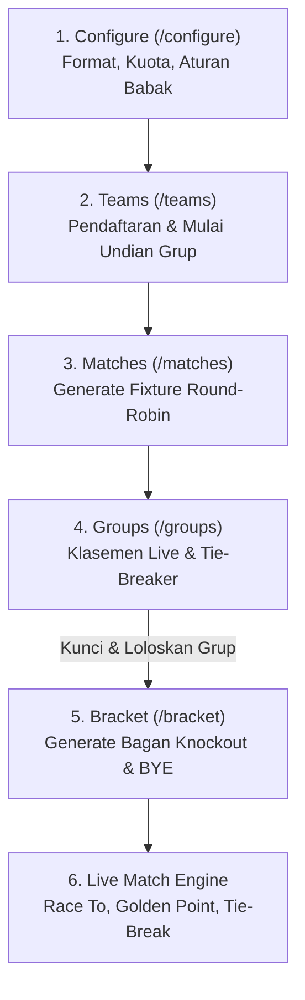

# REVERSE-ENGINEERING SPECIFICATION & ARCHITECTURAL BLUEPRINT
## Target System: stage.padelgigs.id (Event Organizer, Public Portal & Match Engine)
**Authenticated Profile:** `koceevent@padelgigs.id` (KOCE Event)  
**Target Modern Stack:** **Laravel 13** (PHP 8.4+) + **Inertia.js v2** + **React 19** + **Tailwind CSS v4** + **Vite 6**  
**Audit Scope:** Full System (EO Operations, Public Spectator/Player Portal, Match Engine & Superadmin Core)  

---

## 1. SISTEM INTI & ARSITEKTUR KOMPONEN FRONTEND (INERTIA V2 + REACT 19)

Melalui audit sesi aktif di `stage.padelgigs.id`, berikut struktur arsitektur halaman dan komponen Inertia.js yang diekstraksi secara menyeluruh (termasuk Public Portal):

```
resources/js/
├── Pages/
│   ├── Public/                                            # MODUL PUBLIK (SPECTATOR & PLAYERS)
│   │   ├── Home.tsx                                       # / (Landing Page, Ticker Live, Winners, Stats)
│   │   ├── Tournaments/
│   │   │   ├── Index.tsx                                  # /tournaments (Explore, Filter Wilayah, Status)
│   │   │   └── Show.tsx                                   # /tournaments/{id} (Public Hub 6 Tab)
│   │   │       ├── Tabs/LiveScoreTab.tsx                  # Tab 1: Real-time match ticker
│   │   │       ├── Tabs/OrderOfPlayTab.tsx                # Tab 2: Jadwal match & filter babak
│   │   │       ├── Tabs/ResultsTab.tsx                    # Tab 3: Hasil skor akhir
│   │   │       ├── Tabs/LeaderboardTab.tsx                # Tab 4: Klasemen grup publik
│   │   │       ├── Tabs/BracketTab.tsx                    # Tab 5: Bagan pohon knockout live
│   │   │       └── Tabs/SlideshowTab.tsx                  # Tab 6: TV Fullscreen venue projector
│   │   ├── Leaderboard.tsx                                # /leaderboard (Global Player Rankings)
│   │   ├── Winners.tsx                                    # /winners (Hall of Fame Juara Turnamen)
│   │   ├── PlayerRegister.tsx                             # /register/player (Pendaftaran Akun Pemain)
│   │   └── Blog/
│   │       ├── Index.tsx                                  # /blog (Portal Artikel & Berita)
│   │       └── Show.tsx                                   # /blog/{slug} (Detail Artikel SEO)
│   ├── Auth/
│   │   ├── Login.tsx
│   │   ├── Register.tsx
│   │   └── ForgotPassword.tsx
│   ├── Dashboard.tsx                                      # /dashboard (EO Summary Metrics)
│   ├── Settings/
│   │   ├── Profile.tsx                                    # /settings/profile
│   │   ├── Password.tsx                                   # /settings/password
│   │   └── Appearance.tsx                                 # /settings/appearance
│   ├── Organizer/                                         # MODUL EVENT ORGANIZER
│   │   ├── Tournaments/
│   │   │   ├── Index.tsx                                  # /organizer/tournaments
│   │   │   ├── Create.tsx                                 # /organizer/tournaments/create
│   │   │   ├── Show.tsx                                   # /organizer/tournaments/{id}
│   │   │   ├── Edit.tsx                                   # /organizer/tournaments/{id}/edit
│   │   │   ├── CourtControl.tsx                           # /organizer/tournaments/{id}/court-control
│   │   │   ├── Schedule.tsx                               # /organizer/tournaments/{id}/schedule
│   │   │   ├── Courts.tsx                                 # /organizer/tournaments/{id}/courts
│   │   │   ├── Registrations.tsx                          # /organizer/tournaments/{id}/registrations
│   │   │   ├── CheckIn.tsx                                # /organizer/tournaments/{id}/check-in
│   │   │   ├── ScoreLogs.tsx                              # /organizer/tournaments/{id}/score-logs
│   │   │   └── Categories/
│   │   │       ├── Layout.tsx                             # Persistent sub-navigation header
│   │   │       ├── Configure.tsx                          # .../items/{id}/configure
│   │   │       ├── Rules.tsx                              # .../items/{id}/rules
│   │   │       ├── Teams.tsx                              # .../items/{id}/teams
│   │   │       ├── Groups.tsx                             # .../items/{id}/groups (Klasemen)
│   │   │       ├── Matches.tsx                            # .../items/{id}/matches
│   │   │       └── Bracket.tsx                            # .../items/{id}/bracket
│   │   └── Income/
│   │       └── Index.tsx                                  # /organizer/income
│   ├── Referee/
│   │   └── CourtScoring.tsx                               # /referee/court/{token} (Mobile Scoring)
│   └── Admin/                                             # MODUL SUPERADMIN TOTAL
│       ├── Dashboard.tsx                                  # /admin/dashboard
│       ├── Users/Index.tsx                                # /admin/users
│       ├── Roles/Index.tsx                                # /admin/roles (RBAC Granular)
│       ├── WhatsApp/Config.tsx                            # /admin/settings/whatsapp (sidobe.com)
│       ├── WhatsApp/Config.tsx                            # /admin/settings/whatsapp (sidobe.com)
│       ├── Blog/
│       │   ├── Posts.tsx                                  # /admin/blog/posts
│       │   └── Categories.tsx                             # /admin/blog/categories
│       └── Payouts/Index.tsx                              # /admin/payouts
```

---

## 1.1 BEDAH ARSITEKTUR PORTAL PUBLIK (SPECTATORS, PLAYERS & VENUES)

Hasil audit langsung pada modul publik `stage.padelgigs.id`:

### A. Home & Landing Page (`/`)
* **Header & Navbar**:
  * Brand Logo `PADELGIGS` dengan status badge staging.
  * Navigasi utama: `Home`, `Tournaments`, `Players`, Theme Switcher (Dark/Light Mode), dan Tombol Auth Profil (`K`).
* **Hero Section**:
  * Heading: *"HOME OF PADEL PLAYERS & TOURNAMENTS"*.
  * Call-to-Action (CTA): Tombol *"Daftar sebagai Player"* (`/register/player`).
* **Komponen & Widget Beranda**:
  1. `Live Score / Live Today`: Ticker real-time pertandingan yang sedang berlangsung hari ini di seluruh venue turnamen.
  2. `Upcoming Tournaments`: Grid kartu turnamen terdekat dengan filter tanggal dan status.
  3. `Winners of the Month`: Papan penghargaan pemain terbaik dengan gelar juara terbanyak bulan ini.
  4. `Counter Statistik Platform`: Metrik live (1.023+ pemain terdaftar).
  5. `Histories`: Arsip turnamen terdahulu yang telah selesai.
  6. `Direct WhatsApp Floating Support`: Tombol integrasi WhatsApp (`wa.me`) untuk bantuan cepat peserta.
  7. `Official Community Partners`: Mitra resmi (*Padel Societas*, *Connecting Up*, *247*, *Match Lab*).
  8. `Footer`: Hak cipta © 2026 Koceevent, dikembangkan oleh *Burningroom Technology*.

### B. Direktori & Pencarian Turnamen Publik (`/tournaments`)
* **Filter Multi-Kriteria**:
  * Tab Status: `UPCOMING` | `LIVE` | `SELESAI`.
  * Dropdown Wilayah: Filter provinsi / kota turnamen (`Semua Wilayah`).
  * Kolom Pencarian Cepat: Input teks real-time nama turnamen.
* **Layout Kartu Turnamen**:
  * Banner poster turnamen (Aspect ratio 16:9 atau 4:5).
  * Tag nama penyelenggara / EO (contoh: `FOXYID`).
  * Judul Turnamen, Rentang Tanggal (`23 Okt 2026 - 23 Okt 2026`).
  * Nama Venue Lapangan (`Foxy Padel`) & Wilayah (`Kota Surabaya, Jawa Timur`).

### C. Pusat Informasi Turnamen Publik (`/tournaments/{id}`)
Halaman sentral bagi penonton, pemain, dan layar proyektor venue (Diverifikasi langsung dari turnamen aktif *Inpedia Padel Championship 2026*):

1. **Header Banner & Quick Info**:
   * Banner poster turnamen resmi dengan backdrop blur dinamis.
   * Judul Turnamen, Penyelenggara / EO, Tanggal Pelaksanaan, Venue Lapangan & Alamat Google Maps.
   * Quick Status Badge (`UPCOMING`, `LIVE`, `SELESAI`).

2. **6 TAB OPERASIONAL PUBLIK SECARA TOTAL**:

   #### Tab 1: `LIVE SCORE`
   * **Struktur Kartu Lapangan Aktif (`Match Sedang Berlangsung`)**:
     * Badge Lapangan (contoh: `Lapangan 4`, `Lapangan 2`).
     * Info Babak & Grup (contoh: `Bronze - Men | Grup B`).
     * Format Pertandingan (contoh badge: `1SET · FIRST6 · GP` = 1 Pro-Set, First to 6 Games, Golden Point).
     * Status Pill Animasi: `ON COURT` dengan pulsing dot hijau live.
     * Pasangan Tim: Tim 1 (Avatar + Nama Pasangan) vs Tim 2 (Avatar + Nama Pasangan).
     * Skor Game / Set berjalan (misal: `4` - `2`).
     * Tombol Aksi: `See Match Detail` untuk melihat riwayat game demi game secara kronologis.
   * **Kategori Filter**: Filter cepat per kategori pertandingan (`Semua Kategori`, `Bronze - Men`, `Bronze - Women`).
   * **Empty State**: Menampilkan ilustrasi dan teks informatif jika belum ada pertandingan yang sedang berjalan di lapangan.

   #### Tab 2: `ORDER OF PLAY` (Jadwal Pertandingan)
   * Menampilkan seluruh antrian pertandingan turnamen (tercatat total **138 matches** pada staging).
   * **Filter Bar Interaktif 4 Sumbu**:
     1. `Sort Order`: Pilihan *Terlama Terjadwal* (Urut jam mulai paling awal) atau *Terbaru Terjadwal*.
     2. `Filter Babak`: Dropdown dinamis (*Semua Babak*, *Fase Grup*, *Perempat Final*, *Semifinal*, *Final*).
     3. `Filter Kategori`: Dropdown kategori kompetisi (*Semua Kategori*, *Bronze Men*, dst.).
     4. `Pencarian Pemain`: Input teks pencarian nama pemain secara live debounced.
   * **Format Baris Pertandingan**:
     * Tanggal & Jam Mulai (contoh: `24 Okt 2026, 09:00 WIB`).
     * Badge Court Lapangan (contoh: `Court 1`).
     * Badge Babak & Kategori.
     * Status Pertandingan: `PENDING` (Abu-abu), `ON COURT` (Kuning/Hijau live), `COMPLETED` (Biru/Hijau selesai).

   #### Tab 3: `RESULTS` (Hasil Pertandingan Selesai)
   * Menampilkan arsip pertandingan yang telah selesai (tercatat **40 completed matches** pada staging).
   * **Highlight Pemenang**: Baris tim pemenang ditandai dengan font tebal, warna hijau, dan ikon checkmark verifikasi (`✓`).
   * **Breakdown Skor Lengkap**:
     * Menampilkan perolehan skor game per set (contoh: `6 - 3` atau pada format best of 3: `6-4, 4-6, 10-8`).
   * **Filter & Urutan**: Filter babak, kategori, dan sorting `Terbaru Selesai` (menempatkan match yang baru saja tuntas di posisi teratas).

   #### Tab 4: `LEADERBOARD` (Klasemen Grup Publik)
   * **Toggle Mode Tampilan**:
     * `Per Grup`: Menampilkan klasemen terisolasi per keranjang grup (Grup A, Grup B, Grup C, Grup D).
     * `Lintas Grup` (Overall Aggregate): Menampilkan ranking gabungan seluruh tim dari semua grup untuk menentukan seeding bagan knockout / wildcard best loser.
   * **Pilihan Kategori Tabs**: Tombol tab berganti antar divisi/kategori (*Bronze—Women*, *Bronze—Men*).
   * **Kolom Tabel Standings**:
     * `Pos`: Nomor urut posisi dengan penanda warna hijau bagi tim di zona lolos (*Advancing Cutoff Zone*).
     * `Team`: Nama tim beserta roster pemain.
     * `P` *(Played)*: Total pertandingan.
     * `W` *(Won)*: Total menang match.
     * `L` *(Lost)*: Total kalah match.
     * `WP` *(Won Points/Games)*: Total game yang dimenangkan.
     * `LP` *(Lost Points/Games)*: Total game kebobolan.
     * `Ratio`: Rasio efisiensi poin game.
     * `Win%`: Persentase kemenangan match.

   #### Tab 5: `BRACKET` (Bagan Gugur Interaktif)
   * Visualisasi pohon biner knockout dinamis sesuai babak (*Quarter Finals*, *Semi Finals*, *Finals*, dan *Perebutan Juara 3*).
   * **Slot Mapping Reaktif**:
     * Menampilkan placeholder terstruktur sebelum grup dikunci (contoh: `Winner Group A`, `Runner Up Group B`, `TBD`).
     * Saat grup dikunci, nama tim langsung terisi otomatis.
     * Kotak skor tim di setiap simpul bagan.
   * **Fitur Utility Penonton**:
     * Tombol `Unduh Gambar`: Mengunduh visual bagan resolusi tinggi dalam format PNG/PDF untuk dibagikan ke WhatsApp grup komunitas.

   #### Tab 6: `SLIDESHOW` (TV Venue Display Mode)
   * Fitur khusus untuk dipasang pada proyektor atau smart TV 65–85 inch di venue turnamen.
   * **Tombol Akses**: `Buka Slideshow` yang membuka layar penuh (*Fullscreen Kiosk Mode*).
   * **Mekanisme Rotasi Layar Otomatis**:
     * Layar 1: *Live Court Monitor* (skor langsung court 1, 2, 3, dst.).
     * Layar 2: *Order of Play Next Matches* (pertandingan yang akan segera dipanggil).
     * Layar 3: *Group Standings Leaderboard* (update klasemen terkini).
     * Layar 4: *Knockout Bracket Tree*.
   * Interval transisi slide otomatis (default 10 detik per slide) dengan QR Code resmi turnamen di sudut layar agar penonton dapat scan langsung dengan smartphone.

### D. Direktori Pemain, Profil Single Player & Juara Global

#### 1. Halaman Profil Single Player (`/leaderboard/{uuid}`)
Diverifikasi langsung dari profil aktif pemain: `https://stage.padelgigs.id/leaderboard/019eb4e0-cf1f-7364-b7dd-8de97d2fba3f` (*Jason Sugihan P.*):
* **Header Profil Pemain**:
  * Foto profil avatar pemain dan nama lengkap.
* **Grid 4 Kartu Metrik Performa Inti**:
  * `MAIN`: Total pertandingan yang telah dimainkan (contoh: `23`).
  * `MENANG`: Total kemenangan pertandingan (contoh: `16`).
  * `WIN RATE`: Rasio persentase kemenangan (contoh: `70%`).
  * `JUARA`: Jumlah gelar piala/turnamen yang dimenangkan (contoh: `1`).
* **Seksi Statistik Performa Tahunan ("Statistik per tahun")**:
  * Filter dropdown tahun (contoh: `2026`).
  * Gauge visual ringkasan tahunan (Win Rate %, total main, menang, kalah).
  * **Interactive Line Chart ("Tren Performa")**: Grafik linimasa bulanan (Januari - Desember) dengan kurva hijau (*Menang*) dan kurva merah (*Kalah*).
* **Riwayat Turnamen ("Riwayat Turnamen")**:
  * Tab toggle: `Public` vs `Community`.
  * Daftar kartu turnamen yang diikuti, tanggal main, dan badge pencapaian tertinggi babak (*GROUP STAGE*, *QUARTER FINALS*, *SEMI FINALS*, *WINNER*).

#### 2. Hall of Fame Juara Global (`/winners`)
* Direktori para juara turnamen PadelGigs (Juara 1, 2, dan 3) per kategori turnamen yang telah selesai.

---

### E. Alur Pendaftaran Akun Pemain (`/register` & `/register/player`)
* **Skema Data Akun (User & Player Profile)**:
  * `name`: Nama lengkap pemain.
  * `phone`: Nomor handphone / WhatsApp aktif (terintegrasi otomatis untuk notifikasi jadwal match via sidobe.com).
  * `email`: Email aktif untuk login dan receipt pembayaran.
  * `password` & `password_confirmation`.
  * `gender`: `male` | `female`.
  * `skill_level`: 'Newbie' | 'Rookie' | 'Beginner' | 'Upper Beginner' | 'Intermediate' | 'Lower Bronze'.
  * `preferred_side`: `left` | `right` (Posisi sisi bermain padel).
  * `dominant_hand`: `right` | `left` (Tangan dominan).
  * `city_id` / `province_id`: Wilayah domisili pemain.
* **Alur Sistem**:
  * Pendaftaran publik $\rightarrow$ Akun dibuat dengan role `player` $\rightarrow$ Profile player seeded di database $\rightarrow$ Otomatis terafiliasi dengan papan Leaderboard nasional sejak pertandingan turnamen pertama dimainkan.

---

### F. Alur Pendaftaran Turnamen Publik (Tournament Registration Flow)
Diakses melalui tombol CTA *"Daftar"* / *"Daftar Sekarang"* pada halaman turnamen:
1. **Langkah 1: Pemilihan Kategori**:
   * Peserta memilih kategori kompetisi yang dibuka (contoh: *Bronze Men*, *Bronze Women*, *Community Beginner*).
   * Menampilkan info biaya pendaftaran (Registration Fee) dan sisa kuota tim.
2. **Langkah 2: Data Tim & Kapten (Player 1)**:
   * Input `Nama Tim` (Team Name).
   * Data Player 1 otomatis terisi (*pre-filled*) dari akun pemain yang sedang login (Nama, No WA, Email).
3. **Langkah 3: Integrasi Partner (Player 2)**:
   * Fitur pencarian pemain terdaftar di database PadelGigs berdasarkan Nama / Email / Nomor WhatsApp.
   * Opsi input manual (Guest Partner) jika partner belum memiliki akun: Nama, No WhatsApp, Gender, dan Skill Level.
4. **Langkah 4: Kuesioner Kustom Turnamen (EO Configurable Form)**:
   * Pilihan ukuran jersey (*Jersey Size*: S, M, L, XL, XXL).
   * Nomor KTP / NIK (untuk verifikasi identitas / asuransi atlet).
   * Kontak Darurat (*Emergency Contact*: Nama & Nomor Telepon).
5. **Langkah 5: Rincian Pembayaran & Verifikasi Transfer**:
   * Ringkasan total biaya (Biaya Turnamen + Platform Fee jika ada).
   * Pilihan metode bayar: Rekening Transfer Manual EO, QRIS, atau Virtual Account.
   * Upload bukti transfer (Bukti Bayar Image/PDF).
6. **Langkah 6: Konfirmasi Sukses & Trigger WhatsApp sidobe.com**:
   * Registrasi masuk ke status `Pending Verification` di dashboard EO.
   * Sistem otomatis men-dispatch pesan WhatsApp ke nomor HP kedua pemain mengonfirmasi pendaftaran telah diterima dan menunggu verifikasi panitia.

---

### G. Portal Blog & Berita Komunitas (`/blog`, `/blog/{slug}`)
* Berdasarkan kebutuhan pengguna ("blog dll secara total"), platform dilengkapi CMS artikel publik terintegrasi dengan Superadmin:
  * Artikel tips & trik bermain padel, review raket, berita turnamen, dan regulasi resmi.
  * Meta SEO otomatis (OpenGraph image, structured data, canonical link).

---

## 2. BEDAH LOGIKA MENDALAM: KATEGORI PERTANDINGAN (MATCH ENGINE TOTAL)

Audit mendalam pada sub-rute `/items/{categoryId}/` mengungkap alur data, model matematika, dan logika algoritma sebagai berikut:



---

### 2.1 Tab Konfigurasi Kategori (`/configure`)

#### A. Opsi Format Pertandingan:
1. **`Group + Knockout`**: Fase grup setengah kompetisi diikuti sistem gugur dengan bagan eliminasi.
2. **`Knockout Only`**: Sistem gugur murni sejak babak pertama (R32, R16, QF, SF, F).
3. **`League / Round Robin`**: Format liga klasemen penuh tanpa babak eliminasi.

#### B. Parameter Distribusi Grup:
* **`kuota_tim`** *(Number, e.g. 12)*: Total slot pendaftaran.
* **`tim_per_grup`** *(Number, e.g. 6)*: Jumlah anggota per grup.
* **`tim_lolos_per_grup`** *(Number, e.g. 3)*: Jumlah tim yang berhak melaju ke fase gugur dari tiap grup.
* **`leg_pertandingan`** *(1 Leg vs 2 Legs)*: Single round vs Home-and-Away.
* **`jumlah_grup`** *(Optional Number, e.g. 2 Grup: A & B)*: Dihitung otomatis: $\lceil \text{kuota\_tim} / \text{tim\_per\_grup} \rceil$ atau di-override manual.
* **`allow_wildcard`** *(Boolean Toggle)*: Mengizinkan tim terbaik non-lolos (Best Loser) melaju untuk menggenapkan kuota bagan $2^n$.
* **`has_third_place`** *(Boolean Toggle: Perebutan Juara 3)*: Menghasilkan pertandingan tambahan otomatis antara 2 tim yang kalah di Semifinal.
* **`metode_knockout`**:
  * `Knockout By Group`: Posisi bagan ditentukan silang grup (Juara Grup A vs Posisi 3 Grup B).
  * `Knockout By Seeding`: Posisi bagan ditentukan dari ranking gabungan (Cross-group aggregate seeding).

#### C. Aturan Pertandingan Per Babak (Independent Rules Engine):
Setiap babak (`Group Stage`, `Quarter Final`, `Semi Final`, `Final`) memiliki konfigurasi independen:
```typescript
interface RoundRule {
  race_to: 3 | 4 | 6 | 8 | 9;           // Jumlah game kemenangan
  format_set: "1_set" | "best_of_3";     // Format set
  tie_break: boolean;                   // Apakah tie-break aktif di 6-6
  tie_break_points: 7;                  // Poin tie-break (menang selisih 2)
  deuce_rule: "golden_point" | "advantage"; // Golden point: 40-40 sudden death
  super_tie_break_set_3: boolean;       // Set 3 diganti super tie break 10 poin
}
```

---

### 2.2 Tab Informasi Rules (`/rules`)
* Menyimpan dokumen aturan resmi yang otomatis tampil di portal publik turnamen (`Tab Rules`).
* **Fitur AI / Rule Generator**: Tombol `Generate Rules` yang menginjeksi template aturan standar turnamen padel internasional (FIP / Padel Indonesia).
* **Upload PDF Rulebook**: Mendukung lampiran file panduan teknis turnamen hingga 10MB.

---

### 2.3 Tab Pendaftaran Tim & Algoritma Undian Grup (`/teams`)
* Menampilkan slot terisi (contoh: `11/12 Slot`), nama Pemain 1 & Pemain 2, avatar, dan status verifikasi.
* Dropdown penempatan grup manual (`Grup A`, `Grup B`, atau `Belum Diterima`).
* **Fitur `Mulai Undian Grup` (Random Draw Engine)**:
  * Mengacak seluruh tim terverifikasi yang belum teralokasi ke dalam grup secara merata dan seimbang.
  * Algoritma pengacakan (Fisher-Yates Shuffle + Round-Robin Bucket Distribution):

```typescript
// Implementasi Algoritma Undian Grup Seimbang (TypeScript)
export function drawTeamsIntoGroups(
  teams: Array<{ id: string; name: string; is_seeded?: boolean }>,
  groupCount: number,
  teamsPerGroup: number
): Record<string, string[]> {
  const groupNames = Array.from({ length: groupCount }, (_, i) => String.fromCharCode(65 + i)); // ['A', 'B', ...]
  const groups: Record<string, string[]> = {};
  groupNames.forEach(g => (groups[g] = []));

  // Pisahkan tim unggulan (seeding) jika ada agar tidak bertemu di grup yang sama
  const seeded = teams.filter(t => t.is_seeded);
  const unseeded = teams.filter(t => !t.is_seeded);

  // Acak tim non-unggulan menggunakan Fisher-Yates
  for (let i = unseeded.length - 1; i > 0; i--) {
    const j = Math.floor(Math.random() * (i + 1));
    [unseeded[i], unseeded[j]] = [unseeded[j], unseeded[i]];
  }

  // Distribusikan seeded terlebih dahulu (1 per grup)
  seeded.forEach((t, idx) => {
    const targetGroup = groupNames[idx % groupCount];
    groups[targetGroup].push(t.id);
  });

  // Distribusikan sisa tim secara merata
  let currentGroupIdx = 0;
  for (const team of unseeded) {
    // Cari grup yang belum penuh
    let attempts = 0;
    while (groups[groupNames[currentGroupIdx]].length >= teamsPerGroup && attempts < groupCount) {
      currentGroupIdx = (currentGroupIdx + 1) % groupCount;
      attempts++;
    }
    groups[groupNames[currentGroupIdx]].push(team.id);
    currentGroupIdx = (currentGroupIdx + 1) % groupCount;
  }

  return groups;
}
```

---

### 2.4 Tab Klasemen & Logika Penentuan Ranking / Tie-Breaker (`/groups`)

#### A. Struktur Tabel Klasemen:
* `No`: Peringkat grup saat ini.
* `Team`: Nama pasangan tim.
* `P` *(Played)*: Total pertandingan selesai.
* `W` *(Won)*: Total kemenangan match.
* `L` *(Lost)*: Total kekalahan match.
* `WP` *(Won Points / Games)*: Total games/points yang dimenangkan.
* `LP` *(Lost Points / Games)*: Total games/points yang dialami (kebobolan).
* `RATIO`: Rasio efektivitas game $\frac{\text{WP}}{\text{WP} + \text{LP}}$ atau $\frac{\text{WP}}{\text{LP}}$.
* `Win%`: Persentase kemenangan match $\frac{\text{W}}{\text{P}} \times 100\%$.

#### B. Algoritma Ranking & Tie-Breaker Standar PadelGigs:
Jika 2 atau lebih tim memiliki rasio kemenangan (`Win%` atau `W`) yang sama, penentuan ranking menggunakan urutan aturan (Tie-Breaker Hierarchy):
1. **Head-to-Head (H2H)**: Hasil pertandingan langsung antara tim yang berselisih.
2. **Game Difference (GD)**: $\text{GD} = \text{WP} - \text{LP}$.
3. **Total Game Won (WP)**: Tim dengan game menang terbanyak.
4. **Game Ratio**: $\text{WP} / \text{LP}$.
5. **Coin Toss / Undian Acak Komite**.

```php
// App\Services\Tournament\StandingsCalculator.php
namespace App\Services\Tournament;

class StandingsCalculator
{
    public static function calculateGroupStandings(array $teams, array $matches): array
    {
        $table = [];
        foreach ($teams as $team) {
            $table[$team['id']] = [
                'team_id' => $team['id'],
                'team_name' => $team['name'],
                'played' => 0,
                'won' => 0,
                'lost' => 0,
                'wp' => 0, // games won
                'lp' => 0, // games lost
                'gd' => 0, // game difference
                'win_pct' => 0.0,
                'ratio' => 0.0,
            ];
        }

        foreach ($matches as $match) {
            if ($match['status'] !== 'completed') continue;
            $t1 = $match['team_1_id'];
            $t2 = $match['team_2_id'];
            $s1 = $match['score_t1'];
            $s2 = $match['score_t2'];

            $table[$t1]['played']++;
            $table[$t2]['played']++;
            $table[$t1]['wp'] += $s1;
            $table[$t1]['lp'] += $s2;
            $table[$t2]['wp'] += $s2;
            $table[$t2]['lp'] += $s1;

            if ($s1 > $s2) {
                $table[$t1]['won']++;
                $table[$t2]['lost']++;
            } else {
                $table[$t2]['won']++;
                $table[$t1]['lost']++;
            }
        }

        foreach ($table as &$row) {
            $row['gd'] = $row['wp'] - $row['lp'];
            $row['win_pct'] = $row['played'] > 0 ? round(($row['won'] / $row['played']) * 100, 1) : 0;
            $row['ratio'] = ($row['wp'] + $row['lp']) > 0 ? round($row['wp'] / ($row['wp'] + $row['lp']), 3) : 0;
        }

        // Sorting dengan Tie-Breaker
        usort($table, function ($a, $b) use ($matches) {
            // 1. Persentase Kemenangan / Poin Menang
            if ($a['won'] !== $b['won']) {
                return $b['won'] <=> $a['won'];
            }

            // 2. Head-to-Head jika persis 2 tim
            $h2hWinner = self::getH2HWinner($a['team_id'], $b['team_id'], $matches);
            if ($h2hWinner === $a['team_id']) return -1;
            if ($h2hWinner === $b['team_id']) return 1;

            // 3. Selisih Game (Game Difference)
            if ($a['gd'] !== $b['gd']) {
                return $b['gd'] <=> $a['gd'];
            }

            // 4. Game Menang (WP)
            if ($a['wp'] !== $b['wp']) {
                return $b['wp'] <=> $a['wp'];
            }

            // 5. Ratio Game
            return $b['ratio'] <=> $a['ratio'];
        });

        return array_values($table);
    }

    private static function getH2HWinner(string $t1, string $t2, array $matches): ?string
    {
        foreach ($matches as $m) {
            if ($m['status'] !== 'completed') continue;
            if (($m['team_1_id'] === $t1 && $m['team_2_id'] === $t2) || ($m['team_1_id'] === $t2 && $m['team_2_id'] === $t1)) {
                if ($m['team_1_id'] === $t1) {
                    return $m['score_t1'] > $m['score_t2'] ? $t1 : $t2;
                } else {
                    return $m['score_t2'] > $m['score_t1'] ? $t1 : $t2;
                }
            }
        }
        return null;
    }
}
```

---

### 2.5 Tab Pertandingan & Algoritma Penjadwalan Round-Robin (`/matches`)
* Fixture fase grup digenerate secara otomatis menggunakan **Algoritma Berger (Circle Method)**:
  * Jika jumlah tim ganjil, tambahkan 1 tim bayangan `DUMMY/BYE`.
  * Tim 1 dikunci di posisi pertama, tim lainnya diputar searah jarum jam setiap putaran (Round).
  * Untuk format 2 Legs, daftar jadwal putaran 1 diduplikasi dengan posisi Home/Away ditukar.

```php
// App\Services\Tournament\FixtureGenerator.php
namespace App\Services\Tournament;

class FixtureGenerator
{
    public static function generateRoundRobin(array $teamIds, int $legs = 1): array
    {
        $count = count($teamIds);
        $teams = $teamIds;
        $hasBye = false;

        if ($count % 2 !== 0) {
            $teams[] = null; // BYE team
            $count++;
            $hasBye = true;
        }

        $rounds = [];
        $totalRounds = $count - 1;
        $matchesPerRound = $count / 2;

        for ($r = 0; $r < $totalRounds; $r++) {
            $roundMatches = [];
            for ($m = 0; $m < $matchesPerRound; $m++) {
                $home = $teams[$m];
                $away = $teams[$count - 1 - $m];

                if ($home !== null && $away !== null) {
                    $roundMatches[] = [
                        'round' => $r + 1,
                        'team_1_id' => $home,
                        'team_2_id' => $away,
                        'status' => 'pending',
                    ];
                }
            }
            // Putar array kecuali tim pertama (index 0)
            $teams = array_merge([$teams[0]], [end($teams)], array_slice($teams, 1, -1));
            $rounds[] = $roundMatches;
        }

        $allMatches = array_merge(...$rounds);

        if ($legs === 2) {
            $leg2Matches = [];
            foreach ($allMatches as $match) {
                $leg2Matches[] = [
                    'round' => $match['round'] + $totalRounds,
                    'team_1_id' => $match['team_2_id'],
                    'team_2_id' => $match['team_1_id'],
                    'status' => 'pending',
                ];
            }
            $allMatches = array_merge($allMatches, $leg2Matches);
        }

        return $allMatches;
    }
}
```

---

### 2.6 Tab Bagan Knockout & Logika "Kunci & Loloskan Grup" (`/bracket`)

Saat EO mengklik tombol **`Kunci & Loloskan Grup`** di tab Klasemen:
1. Status seluruh grup di-freeze menjadi `LOCKED`.
2. Sistem mengekstrak tim yang lolos berdasarkan `tim_lolos_per_grup` (misal Juara Grup A, Runner-up Grup A, Posisi 3 Grup A, dan Grup B).
3. **Pemberian Slot BYE & Cross Group Matching**:
   * Jika jumlah tim yang lolos tidak memenuhi kelipatan pangkat dua ($4, 8, 16, 32$), tim dengan ranking tertinggi (Juara Grup) mendapatkan slot **BYE** langsung ke babak Semifinal.
   * Format pasangan Perempat Final (Contoh 6 Tim Lolos: Top 3 dari Grup A & B):
     * **QF Match 1**: `Juara Grup A` $\rightarrow$ Mendapatkan **BYE** (Langsung ke Semifinal 1).
     * **QF Match 2**: `Posisi 2 Grup A` vs `Posisi 3 Grup B`.
     * **QF Match 3**: `Juara Grup B` $\rightarrow$ Mendapatkan **BYE** (Langsung ke Semifinal 2).
     * **QF Match 4**: `Posisi 2 Grup B` vs `Posisi 3 Grup A`.
   * **Semifinal Match 1**: `Juara Grup A` vs `Pemenang QF Match 2`.
   * **Semifinal Match 2**: `Juara Grup B` vs `Pemenang QF Match 4`.
   * **Final Match**: `Pemenang SF 1` vs `Pemenang SF 2`.
   * **Perebutan Juara 3 (Bronze Match)**: `Kalah SF 1` vs `Kalah SF 2` (Dibuat otomatis jika opsi `has_third_place` aktif).
4. **Pohon Bagan Interaktif**:
   * Setiap match di tabel `matches` memiliki `next_match_id` (pointer ke pertandingan babak berikutnya) dan `is_loser_match_id` (pointer ke match perebutan juara 3).
   * Saat skor disubmit dan match dinyatakan `completed`, sistem otomatis menempatkan `winner_team_id` ke slot yang bersesuaian di `next_match_id`.

---

## 3. INTEGRASI WHATSAPP GATEWAY SIDOBE.COM LENGKAP

### 3.1 Spesifikasi Payload sidobe.com
* Endpoint Resmi: `POST {base_url}/messages/send-text`
* Format Header: `Authorization: Bearer {api_token}`

```json
{
  "device_id": "session_padelgigs_prod",
  "phone": "6281234567890",
  "message": "Halo Budi & Andi!\n\nPertandingan Anda di *PadeLA Fun Tournament 2026*:\nKategori: Men Beginner\nBabak: Perempat Final (QF 2)\n\nSilakan segera merapat ke *Padelibre Court Barat* dalam 10 menit.\n\nLive Skor: https://padelgigs.id/t/padela/live"
}
```

### 3.2 Matriks Event & Template Pesan WhatsApp
1. **`EVENT_REGISTRATION_SUBMITTED`**: Dikirim saat tim mendaftar (berisi detail biaya & nomor rekening transfer).
2. **`EVENT_REGISTRATION_APPROVED`**: Dikirim saat EO mengklik Approve tim di tab Registrasi.
3. **`EVENT_GROUP_DRAW_COMPLETED`**: Dikirim saat EO selesai melakukan undian grup (*"Tim Anda masuk ke Grup A"*).
4. **`EVENT_COURT_CALL`**: Triggered dari tombol `Panggil Tim` di Tournament Desk (*"Pertandingan Anda di Court Barat dimulai 10 menit lagi"*).
5. **`EVENT_MATCH_RESULT`**: Dikirim ke kedua tim setelah skor akhir disubmit wasit.
6. **`EVENT_ADVANCE_KNOCKOUT`**: Dikirim saat tim dipastikan lolos dari fase grup ke babak gugur.

---

## 4. SUPERADMIN PLATFORM & RBAC TOTAL

Superadmin mengendalikan arsitektur multi-tenant EO:
* **Manajemen Role (Spatie)**: Superadmin, Finance, Content Editor, EO, Tournament Desk, Wasit (Token/PIN), Pemain.
* **Impersonation**: Login satu klik sebagai EO untuk investigasi insiden tanpa meminta password.
* **Master Wilayah**: Provinsi dan Kota/Kabupaten Indonesia untuk penentuan venue turnamen.
* **Finance Ledger & Payout Approval**: Approval pencairan dana EO dengan verifikasi mutasi rekening.
* **Blog CMS**: Manajemen artikel, ulasan raket, tips, dan OpenGraph SEO meta.

### 4.1 Modul Master Data Dinamis Superadmin (Tier, Divisi, Skill Level)
Untuk menghindari *hardcoded enum* dan memberikan fleksibilitas total kepada pemilik platform:

* **Tabel Basis Data**:
  * `master_tiers`: `id (uuid)`, `name`, `slug`, `badge_color`, `description`, `sort_order`, `is_active`, `deleted_at`, `timestamps`.
  * `master_divisions`: `id (uuid)`, `name`, `slug`, `gender_restriction`, `sort_order`, `is_active`, `deleted_at`, `timestamps`.
  * `master_skill_levels`: `id (uuid)`, `name`, `slug`, `min_rating`, `max_rating`, `description`, `sort_order`, `is_active`, `deleted_at`, `timestamps`.

* **Rute & Endpoint API Admin**:
  ```text
  GET    /admin/master/tiers                     -> MasterTierController@index
  POST   /admin/master/tiers                     -> MasterTierController@store
  PUT    /admin/master/tiers/{id}                -> MasterTierController@update
  PATCH  /admin/master/tiers/{id}/toggle-status  -> MasterTierController@toggleStatus
  DELETE /admin/master/tiers/{id}                -> MasterTierController@destroy (Soft Delete)
  PATCH  /admin/master/tiers/reorder             -> MasterTierController@reorder

  GET    /admin/master/divisions                 -> MasterDivisionController@index
  POST   /admin/master/divisions                 -> MasterDivisionController@store
  PUT    /admin/master/divisions/{id}            -> MasterDivisionController@update
  PATCH  /admin/master/divisions/{id}/toggle-status -> MasterDivisionController@toggleStatus
  DELETE /admin/master/divisions/{id}            -> MasterDivisionController@destroy (Soft Delete)
  PATCH  /admin/master/divisions/reorder         -> MasterDivisionController@reorder

  GET    /admin/master/skill-levels              -> MasterSkillLevelController@index
  POST   /admin/master/skill-levels              -> MasterSkillLevelController@store
  PUT    /admin/master/skill-levels/{id}         -> MasterSkillLevelController@update
  PATCH  /admin/master/skill-levels/{id}/toggle-status -> MasterSkillLevelController@toggleStatus
  DELETE /admin/master/skill-levels/{id}         -> MasterSkillLevelController@destroy (Soft Delete)
  PATCH  /admin/master/skill-levels/reorder      -> MasterSkillLevelController@reorder
  ```

* **Mekanisme Reaktif & Snapshot Protection**:
  1. **Model Observer Cache Eviction**: Saat Superadmin menambah/mengedit/menghapus master tier, divisi, atau skill, observer otomatis menghapus cache: `Cache::tags(['master_data'])->flush()`.
  2. **Dropdown EO Real-Time**: Halaman pembuatan turnamen EO (`/organizer/tournaments/create`) memanggil dropdown yang langsung tersinkronisasi dari data aktif (`where('is_active', true)->orderBy('sort_order')`).
  3. **Snapshot Integrity**: Saat EO membuat kategori turnamen, kolom `tier_name`, `division_name`, dan `skill_level_name` disimpan sebagai snapshot string permanen di samping foreign key `tier_id`, `division_id`, `skill_level_id`. Jika Superadmin menonaktifkan atau meng-soft-delete data master tersebut, data turnamen yang sudah lampau tetap utuh 100% tanpa error query atau relasi null.

