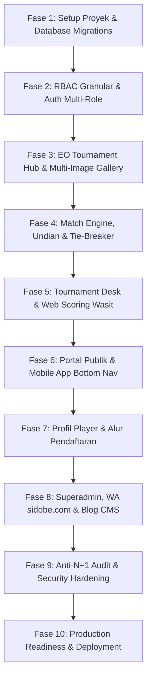

# EXECUTION ROADMAP & ENGINEERING SPECIFICATION
## PadelGigs Core Tournament, EO OS & Superadmin Platform
**Tech Stack:** Laravel 13 (PHP 8.4+), Inertia.js v2, React 19 (TypeScript), Tailwind CSS v4, Vite 6, Redis, Laravel Reverb  
**Standards:** Clean Code, Anti-N+1 Prevention, Strict Validation, Anti-XSS, Anti-SQL Injection, Rate Limiting  
**Target Architecture:** Modular Service-Action Pattern, Form Requests, DTOs, Strict Type Safety  
**Date:** Oktober 2026  

---

## 1. PRINSIP ARSITEKTUR & KEAMANAN SISTEM (ZERO-VULNERABILITY STANDARD)

Untuk mencegah cacat arsitektur, celah keamanan, dan masalah performa pada beban tinggi (high concurrency saat turnamen berlangsung), seluruh kode wajib mematuhi standar berikut:

### 1.1 Strategi Dual-Database: SQLite (Development) & MySQL 8.0+ (Production)
Untuk mempercepat siklus iterasi lokal tanpa mengorbankan performa produksi, sistem menggunakan arsitektur dual-driver database:

1. **Lingkungan Development (`APP_ENV=local` / `testing`)**:
   * **Engine:** **SQLite 3** (`database/database.sqlite`).
   * **Keunggulan:** Portabel, nol konfigurasi, instan, hemat RAM, dan eksekusi test runner (Pest/PHPUnit) ultra-cepat.
   * **Konfigurasi Khusus:** Memastikan integritas relasi dengan mengaktifkan Foreign Key Constraints di `config/database.php`:
     ```php
     'sqlite' => [
         'driver' => 'sqlite',
         'database' => database_path('database.sqlite'),
         'foreign_key_constraints' => true,
     ],
     ```
2. **Lingkungan Produksi (`APP_ENV=production`)**:
   * **Engine:** **MySQL 8.0+** (InnoDB Engine).
   * **Keunggulan:** Mendukung konkurensi ribuan koneksi simultan, row-level pessimistic locking (`FOR UPDATE`) saat submit skor wasit, buffer pool tuning, dan transaksi ACID terisolasi.
   * **Konfigurasi Produksi:**
     * Charset: `utf8mb4`, Collation: `utf8mb4_unicode_ci`.
     * Strict Mode: `true` (mencegah silent truncation pada angka dan string).
3. **Standar Kompatibilitas Lintas Driver (Cross-Driver Compatibility)**:
   * Migrasi schema 100% menggunakan Fluent Blueprint methods (`$table->uuid('id')->primary()`, `$table->decimal('amount', 12, 2)`, `$table->json('match_rules')`).
   * Dilarang menggunakan raw SQL dialect spesifik MySQL (misal: `ON DUPLICATE KEY UPDATE` digantikan oleh metode resmi Laravel `upsert()`).
   * Kolom enum dimodelkan menggunakan PHP 8.4 Backed Enums dengan tipe basis string di database agar kompatibel di SQLite maupun MySQL.

---

### 1.2 Optimasi Database Menyeluruh (Total Database Optimization & Anti-N+1)
1. **Laravel Strict Mode**:
   Diaktifkan di `AppServiceProvider::boot()` untuk melempar exception di lingkungan lokal/staging jika terdeteksi lazy loading (N+1 query) atau mutasi atribut yang tidak terdaftar:
   ```php
   Model::shouldBeStrict(!app()->isProduction());
   ```
2. **Eager Loading Berdisiplin**:
   Semua controller/action dilarang mengakses relasi di dalam loop tanpa eager loading:
   * Menggunakan `with(['categories.courts', 'teams.players.user', 'matches.winnerTeam'])`.
   * Menggunakan `withCount(['teams', 'matches'])` daripada memuat seluruh koleksi relasi hanya untuk menghitung total.
3. **Peta Indeks Database Komposit (High-Frequency Index Mapping)**:
   * `tournaments`: `index(['status', 'start_date'])`, `index(['user_id', 'status'])`.
   * `tournament_categories`: `index(['tournament_id', 'format'])`.
   * `teams`: `index(['category_id', 'payment_status'])`, `index(['group_name'])`.
   * `team_players`: `index(['team_id', 'is_captain'])`, `index(['user_id'])`, `index(['phone'])`.
   * `matches`: `index(['category_id', 'stage', 'status'])`, `index(['court_id', 'status'])`, `index(['scheduled_time'])`, `index(['winner_team_id'])`.
   * `score_logs`: `index(['match_id', 'created_at'])`.
   * `player_stats`: `unique(['user_id', 'year', 'month'])`, `index(['win_rate', 'points'])`.
   * `whatsapp_logs`: `index(['recipient_phone', 'status'])`, `index(['created_at'])`.
4. **Strategi Pagination & Batch Processing**:
   * Menggunakan `cursorPaginate()` untuk linimasa match feed dan papan leaderboard agar tidak membebani database dengan query `OFFSET` lambat pada ribuan baris data.
   * Ekspor data masal dan batch background job wajib menggunakan `chunkById(100)` atau PHP lazy collections `cursor()`.
5. **Tiering Cache Redis Terintegrasi**:
   * Data statis berulang (master wilayah, daftar rules standar, kategori aktif) disimpan dalam Redis Cache dengan TTL 24 jam.
   * Cache Invalidation otomatis menggunakan **Eloquent Model Observers** (`TournamentObserver`, `MatchObserver`) yang otomatis menghapus key cache saat ada data pertandingan yang berubah.

---

### 1.2 Keamanan Payload, Sanitasi XSS & Anti-SQL Injection
1. **Dedicated Form Requests**:
   Dilarang memvalidasi request langsung di controller. Setiap mutasi memiliki class Form Request terpisah (`CreateTournamentRequest`, `ConfigureRulesRequest`, `SubmitScoreRequest`, dll.) dengan aturan validasi eksplisit (*strict type, regex, in-enums, max length*).
2. **Perlindungan Mass Assignment**:
   Seluruh Eloquent Model menggunakan `$fillable` eksplisit atau `$guarded = ['id']` dengan mutasi yang dikontrol melalui DTO / Form Request.
3. **Pencegahan SQL Injection**:
   * Menggunakan parameter binding bawaan PDO Eloquent secara 100%.
   * Dilarang menggunakan `DB::raw()` dengan konkatenasi string input pengguna (`$request->input`). Jika raw query mutlak diperlukan, gunakan parameter bindings: `DB::raw('score_t1 > ?', [$targetScore])`.
4. **Pencegahan Stored & Reflected XSS**:
   * Seluruh output teks di React 19 di-render melalui JSX yang secara otomatis melakukan HTML entity escaping (`{tournament.name}`).
   * Deskripsi turnamen yang menggunakan Rich Text diwajibkan melewati sanitizer server-side menggunakan `mews/purifier` (HTMLPurifier) dengan whitelist tag aman (`<p>`, `<b>`, `<i>`, `<ul>`, `<li>`, `<h3>`) sebelum disimpan ke database.
5. **Keamanan Upload File Media**:
   * Validasi ketat MIME type (`image/jpeg,image/png,image/webp`) dan ukuran maksimal (Poster 5MB, Rulebook PDF 10MB).
   * File disimpan dengan UUID acak (`Str::uuid() . '.' . $extension`) untuk mencegah *Path Traversal* dan eksekusi file berbahaya.

---

### 1.3 Rate Limiting & Concurrency Controls
1. **WhatsApp Gateway Protection**:
   * Rate limiting pada endpoint trigger WhatsApp: 30 pesan per menit per user untuk mencegah spam dan pemblokiran session sidobe.com.
   * Background job pengiriman menggunakan Redis Queue dengan retry limit (max 3 kali) dan *exponential backoff*.
2. **Pessimistic Locking pada Skor Lapangan**:
   * Saat wasit menginput skor game atau advance bracket, transaksi database dibungkus dalam `DB::transaction()` dengan `lockForUpdate()` pada row match agar tidak terjadi *race condition* jika dua wasit/admin mengupdate skor di detik yang sama.

---

## 2. ROADMAP IMPLEMENTASI 10 FASE (STEP-BY-STEP BREAKDOWN)



---

### FASE 1: INISIALISASI PROYEK, ARSITEKTUR BASIS & DATABASE (HARI 1 - 2)

#### 1.1 Inisialisasi Stack Modern & Library Lengkap
* [x] Buat project baru menggunakan **Laravel 13** (PHP 8.4+).
* [x] Pasang adapter **Inertia.js v2** (`@inertiajs/react`, `inertiajs/inertia-laravel`).
* [x] Pasang frontend **React 19**, **TypeScript 5.x**, dan **Vite 6**.
* [x] Pasang engine **Tailwind CSS v4** dengan plugin `@tailwindcss/vite` dan font tokens (`Outfit`, `Inter`, `JetBrains Mono`).
* [x] **Paket Inti Backend (Composer Packages)**:
  * [x] `laravolt/indonesia`: Database offline resmi 38 Provinsi, 514 Kota/Kabupaten, Kecamatan Kemendagri BPS untuk registrasi atlet & venue turnamen.
  * [x] `spatie/laravel-permission`: RBAC granular (Superadmin, EO, Wasit, Pemain, Blog Editor).
  * [x] `mews/purifier`: HTMLPurifier untuk sanitasi anti-XSS konten TipTap editor.
  * [x] `simplesoftwareio/simple-qrcode`: Generator QR Code SVG untuk akses wasit tanpa login (`/referee/{token}`) & live score kiosk.
  * [x] `barryvdh/laravel-dompdf`: Generator file PDF untuk jadwal pertandingan, sertifikat juara, dan bagan bracket.
  * [x] `intervention/image`: Pengolah gambar & WebP converter untuk galeri multi-foto turnamen.
  * [x] `tightenco/ziggy`: TypeScript routing helper bawaan Laravel untuk Inertia.
  * [x] `laravel/reverb`: WebSocket server native untuk update live score real-time.
  * [x] `predis/predis`: Redis client untuk queue WhatsApp sidobe.com dan cache tags master data.
* [x] **Paket Inti Frontend (NPM Packages)**:
  * [x] **TipTap Editor**: `@tiptap/react`, `@tiptap/starter-kit`, `@tiptap/extension-image`, `@tiptap/extension-link`, `@tiptap/extension-placeholder`, `@tiptap/extension-youtube` (untuk Blog CMS & Panduan Pendaftaran Turnamen).
  * [x] **Unified Motion Engine**: `motion` (`motion/react` v12) untuk page transitions, modal spring, reorder animations, tab indicators, dan SVG dynamic path animation (`pathLength` glow beam pada Knockout Bracket).
  * [x] **Pure CSS GPU Micro-Animations (Zero JS Overhead)**: Rotasi 360° stadium radar, pulsating live court beacon, dan shimmer skeletons via Tailwind CSS v4 `@keyframes`.
  * [x] **Selebrasi Juara**: `canvas-confetti` & `@types/canvas-confetti` untuk efek selebrasi podium juara dan konfirmasi pendaftaran.
  * [x] **Ikon Dinamis**: `lucide-react` (100% Vector icons dinamis, Zero Emojis).
  * [x] **Mobile Experience**: `vaul` (Native-like iOS bottom sheet drawers).
  * [x] **Galeri Foto**: `embla-carousel-react` (Touch swipe carousel) & `yet-another-react-lightbox` (Fullscreen photo lightbox).
  * [x] **Drag & Drop**: `@hello-pangea/dnd` untuk jadwal match matrix dan reorder master data.
  * [x] **Notifikasi & Visual**: `sonner` (Glassmorphism toast) & `recharts` (Radar skill 5 dimensi & kurva performa).
* [x] Konfigurasi Dual-Database: **SQLite** (`database/database.sqlite`) dengan foreign keys aktif untuk local dev & test ultra-cepat, serta driver **MySQL 8.0+ InnoDB** teroptimasi untuk produksi.

#### 1.2 Fondasi Anti-N+1 & Standar Clean Code
* [x] Konfigurasi `Model::shouldBeStrict(!app()->isProduction())` di `AppServiceProvider`.
* [x] Buat struktur direktori Clean Architecture:
  * [x] `app/Services/` (Bisnis logika: `SidobeWhatsAppService`, `StandingsCalculatorService`).
  * [x] `app/Actions/` (`DrawTeamsIntoGroupsAction`, `GenerateRoundRobinFixturesAction`, `GenerateKnockoutBracketAction`).
  * [x] `app/Http/Requests/` (Dedicated Form Requests: `StoreTournamentRequest`, dll.).
  * [x] `app/Http/Resources/` (DTO JSON transformations: `TournamentResource`, `PlayerResource`).

#### 1.3 Migrasi Database Relasional ACID Lengkap (UUID Primary Keys)
* [x] Migration `create_users_table` (dilengkapi bio padel: `gender`, `skill_level`, `preferred_side`, `dominant_hand`, `city_id`).
* [x] Migration `create_tournaments_table` (meta, venue, alamat, bank accounts, status).
* [x] Migration `create_tournament_images_table` (mendukung multi-image gallery dengan flag `is_featured`).
* [x] Migration `create_tournament_categories_table` (kuota, format, json match_rules, wildcard, third_place).
* [x] Migration `create_courts_table` (nama lapangan, referee_token 64-char, referee_pin, is_active).
* [x] Migration `create_teams_table` (kategori, nama tim, status bayar, total, bukti transfer, presensi).
* [x] Migration `create_team_players_table` (player 1 & 2, NIK, ukuran jersey, kontak darurat).
* [x] Migration `create_matches_table` (babak, stage, ronde, relasi court, skor set 1-3, `next_match_id`, `loser_next_match_id`).
* [x] Migration `create_score_logs_table` (audit trail skor lama $\rightarrow$ baru, referee/admin id).
* [x] Migration `create_player_stats_table` (data agregat tahunan & bulanan untuk grafik tren performa).
* [x] Migration `create_whatsapp_configs_and_logs_table` (kredensial sidobe.com, templates, log pengiriman).
* [x] Migration `create_blog_posts_and_categories_table` (artikel, kategori, tag, SEO meta).
* [x] Migration `create_payout_requests_table` (permintaan pencairan dana EO & bukti bayar).

---

### FASE 2: RBAC GRANULAR & SISTEM AUTENTIKASI MULTI-ROLE (HARI 3)

#### 2.1 Konfigurasi Spatie Laravel-Permission & Seeding Matrix
* [x] Setup Roles: `superadmin`, `organizer`, `tournament_desk`, `referee`, `player`, `content_editor`.
* [x] Seeding Permission Matrix (Matriks 13 Granular Permissions Bagian 3.1 BRD.md di `RoleAndUserSeeder.php`).
* [x] Middleware proteksi rute:
  * [x] `role:superadmin` untuk rute `/admin/*`.
  * [x] `role:organizer|superadmin` untuk rute `/organizer/*`.
  * [x] `auth` untuk profil & pendaftaran turnamen.
* [x] Superadmin User Management (`/admin/users`) dengan inline role switcher dan status toggle.

#### 2.2 Autentikasi & Impersonation
* [x] Login, Register, Forgot Password menggunakan Inertia + React 19.
* [x] Implementasi **Impersonation System** (Superadmin dapat masuk sebagai EO tertentu dengan satu klik, dilengkapi Floating Banner kuning untuk kembali ke Superadmin).

---

### FASE 3: DASHBOARD EO, TOURNAMENT HUB & MULTI-IMAGE GALLERY (HARI 4 - 5)

#### 3.1 Listing & Filter Turnamen EO (`/organizer/tournaments`)
* [x] Tabel daftar turnamen EO dengan pagination teroptimasi (`cursorPaginate` / `paginate`).
* [x] Search query debounced dan filter status (*Draft, Published, Ongoing, Finished*).

#### 3.2 Wizard Pembuatan Turnamen Multi-Step (`/organizer/tournaments/create`)
* [x] **Multi-Image Media Uploader**:
  * [x] Dropzone upload hingga 10 file dengan drag-and-drop reordering.
  * [x] Otomatis menetapkan foto pertama sebagai *Featured Image* dengan opsi klik bintang untuk memilih poster utama.
* [x] Form Informasi Dasar (Nama, Kategori Olahraga, Deskripsi dengan HTMLPurifier sanitasi).
* [x] Form Lokasi (Venue, Alamat, Dropdown API Wilayah Indonesia: Provinsi & Kota).
* [x] Form Rekening Bank Penarikan (Nama Bank, Nomor Rekening, Pemilik Rekening).
* [x] Dynamic Category Repeater: Tier (`Mini`, `Grand`, `Open`, `Community`), Divisi (`Men`, `Women`, `Mixed`, `Open`), Level Skill (`Newbie`, `Rookie`, `Beginner`, `Upper Beginner`, `Intermediate`, `Lower Bronze`), serta toggle *Buka Pendaftaran*.
* [x] Penyimpanan turnamen, galeri multi-gambar, dan kategori terbungkus dalam `DB::transaction()` dengan proteksi snapshot integrity.

#### 3.3 Pusat Operasional Turnamen (`/organizer/tournaments/{id}`)
* [x] Header ringkasan turnamen, status pill, tombol *Publikasikan*.
* [x] Grid kartu kategori dengan kuota terisi dan tombol *Kelola Kategori*.
* [x] Akses Wasit Mandiri dengan token rahasia & PIN per lapangan, serta 1-click copy link.
* [x] Galeri foto media dan detail rekening bank penarikan.

---

### FASE 4: CATEGORY ENGINE, UNDIAN SEIMBANG & TIE-BREAKER (HARI 6 - 7)
* [x] Form aturan independen per babak (Race to 3/4/6, Golden Point vs Advantage, Wildcard & Bronze Match).
* [x] Sub-Tab Tim & Undian Grup Terdistribusi:
  * Algoritma Fisher-Yates + Seeding Isolation (Unggulan Seed 1 & 2 dipisah ke Grup A dan B).
  * Modal input pendaftaran manual tim & atlet oleh EO.
* [x] Sub-Tab Pertandingan & Generator Fixture:
  * Algoritma Berger (Circle Method) round-robin babak grup.
* [x] Sub-Tab Klasemen 6-Tingkat Tie-Breaker deterministik:
  * Poin -> Head-to-Head -> Game Difference -> Games Won -> Fewest Games Lost -> Alfabetis.
  * Highlight zona hijau kualifikasi lolos ke babak gugur.
* [x] Sub-Tab Bagan Knockout:
  * Cross-group binary tree knockout generator (A1 vs B2, B1 vs A2, Final & Perebutan Juara 3).
  * Visual bracket tree dengan SVG connector flow.

---

### FASE 5: TOURNAMENT DESK, LIVE SCORING & AKSES WASIT TOKEN (HARI 8 - 9)
* [x] Real-time Court Control Board (`/organizer/tournaments/{id}/court-control`):
  * Grid monitor lapangan kontras tinggi (Vacant vs Ongoing).
  * Antrean pertandingan (Match Queue) dan assign match ke lapangan kosong.
  * 1-click status switcher & modal penentuan skor dan pemenang resmi.
* [x] Web Scoring Wasit Mobile Berbasis Token (`/referee/{token}`):
  * Akses instan wasit via Court Token unik tanpa login akun.
  * Antarmuka sentuh 44px+ mobile-first (Point 0, 15, 30, 40, Golden Point), Serve toggle, dan Game counter.
  * Pessimistic locking database (`lockForUpdate()`) saat update skor mencegah race condition.
  * Animasi selebrasi confetti kemenangan saat match selesai.
* [x] Meja Registrasi, Presensi Check-in & Pembayaran (`/organizer/tournaments/{id}/check-in`):
  * Filter & pencarian atlet, toggle kehadiran instan (`is_checked_in`), dan verifikasi pembayaran.
* [x] Audit log riwayat skor (`score_logs`) & Generator PDF *Official Match Sheet* (`/organizer/tournaments/{id}/matches/{matchId}/pdf`).

---

### FASE 6: PORTAL PUBLIK, SINGLE TURNAMEN & MOBILE APP BOTTOM NAV (HARI 10 - 11)
* [x] Beranda Publik & Radar Lapangan (`/`):
  * Ticker Live Match Stadium Radar dengan bola bergerak dinamis & score updates.
  * Pencarian dan filter wilayah provinsi Kemendagri BPS.
  * Kartu turnamen interaktif dengan circular progress kuota pendaftaran.
  * Hall-of-Fame kartu atlet 3 pemain terbaik pilihan.
* [x] **Katalog Turnamen Terpadu (`/tournaments`)**:
  * Status Filter Tabs: `Semua`, `Mendatang (Upcoming)`, `Sedang Berlangsung (Live)`, `Selesai`.
  * Pencarian instan dan filter wilayah Kemendagri BPS.
  * Kartu turnamen interaktif dengan circular/linear progress kuota peserta (`x / y Tim`).
* [x] **Peringkat Atlet Nasional & Leaderboard (`/leaderboard` & `/players`)**:
  * Podium Top 3 Atlet (Gold #1, Silver #2, Bronze #3) dengan medali visual dan win rate.
  * Filter gender divisi (`All`, `Men`, `Women`), filter wilayah, dan pencarian instan nama atlet.
  * Tabel komprehensif peringkat #4 s/d #50 dengan link langsung ke Profil Radar 5D.
* [x] **Pusat Pencarian Global & Command Palette (`⌘K` / `Ctrl+K`)**:
  * Modal pencarian cepat terindeks (`/api/search`) meliputi turnamen, atlet, dan artikel blog.
* [x] **Mesin Pengaturan Aksen Dinamis (`ThemeAccentSelector`)**:
  * Volt Padel Lime, WPT Cyan Blue, Clay Court Amber, Emerald Stadium, Hyper Violet via CSS variable injection.
* [x] **Widget Floating WhatsApp Support**:
  * Akses cepat chat panitia turnamen dengan efek green pulse ping.
* [x] Pusat Single Turnamen 6-Tab Publik (`/tournaments/{slug}`):
  * **Galeri Foto Multi-Gambar**: Showcase thumbnail poster turnamen.
  * **Tab `LIVE SCORE`**: Split Scoreboard siaran TV dengan serve point indicator `<Sparkles />` dan linimasa skor game.
  * **Tab `ORDER OF PLAY`**: Timeline jadwal antrean pertandingan.
  * **Tab `RESULTS`**: Arsip skor tuntas dengan highlight pemenang `<CheckCircle2 />`.
  * **Tab `LEADERBOARD`**: Klasemen babak grup dengan garis zona lolos hijau neon.
  * **Tab `BRACKET`**: Bagan pohon biner visual dengan jalur pemenang.
  * **Tab `INFO & PANDUAN`**: Peta venue dan petunjuk teknis.
* [x] **Mode TV Kiosk Fullscreen 16:9 (`/tournaments/{slug}/slideshow`)**:
  * Rasio layar 16:9, rotasi otomatis 10 detik antar layar (Live Match, Upcoming Matches, Leaderboard) dengan toggle fullscreen.
* [x] Arsitektur Mobile App-First (PWA Experience):
  * Komponen `<MobileBottomNav />` menempel di dasar layar mobile dengan dukungan `env(safe-area-inset-bottom)`.
  * 5 Destinasi icon: `Home`, `Turnamen`, `Live Match` (pulsing dot), `Leaderboard`, `Akun / Desk`.

---

### FASE 7: PROFIL SINGLE PLAYER & ALUR PENDAFTARAN TURNAMEN (HARI 12)
* [x] **Profil Single Player (`/players/{id}`)**:
  * Header avatar dan 4 kartu metrik: `MAIN`, `MENANG`, `WIN RATE %`, `JUARA`.
  * Spider Radar Polygon 5-Dimensi (Power, Agility, Serve, Volley, Defense) berbasis `recharts`.
  * Riwayat kejuaraan turnamen yang pernah diikuti dengan status hasil akhir.
* [x] **Alur 6-Step Pendaftaran Turnamen (`/tournaments/{slug}/register`)**:
  * Step 1: Pemilihan Kategori Tanding (Tampil sisa kuota dan biaya pendaftaran).
  * Step 2: Data Pemain 1 (Kapten) - Auto-fill profil login, NIK, No WhatsApp, Ukuran Jersey.
  * Step 3: Data Pemain 2 (Partner) - Nama, No WhatsApp, NIK, Ukuran Jersey.
  * Step 4: Rekap & Ringkasan Biaya Registrasi.
  * Step 5: Pembayaran Transfer Bank EO dengan upload bukti transfer (`payment_receipt_url`).
  * Integrasi data otomatis ke antrean verifikasi check-in panitia.

---

### FASE 8: SUPERADMIN TOTAL, WHATSAPP SIDOBE.COM & BLOG CMS (HARI 13 - 14)

#### 8.1 Integrasi WhatsApp Gateway sidobe.com
* [x] Service `SidobeWhatsAppService` terisolasi dengan logging transaksi lengkap di tabel `whatsapp_logs`.
* [x] Background Job `SendWhatsAppMessageJob` dengan Redis Queue.
* [x] Pengaturan kredensial di `/admin/settings/whatsapp` (Base URL, API Token, Device ID, Webhook Key).
* [x] Template Builder dinamis: Pendaftaran berhasil, Verifikasi tim, Panggilan lapangan (*Court Call*), Hasil skor akhir, dan OTP.
* [x] Sandbox Simulator: Pengujian kirim pesan langsung dari dashboard Superadmin.

#### 8.2 Blog CMS Engine
* [x] CRUD Artikel Blog dengan Rich Text Editor tersanitasi.
* [x] Manajemen Featured Image, Kategori, Tagar, dan status (*Draft, Published*).
* [x] SEO Meta Manager: Slug otomatis, Meta Title, Meta Description, dan OpenGraph Preview.
* [x] Portal publik blog: `/blog` dan `/blog/{slug}`.

#### 8.3 Manajemen Master Data Dinamis Superadmin (Tier, Divisi, Level Skill)
* [x] **Master Tier CRUD (`/admin/master/tiers`)**:
  * [x] Index list dengan tabel reaktif, drag handle reorder urutan, status badge `is_active`, dan indikator total kategori aktif.
  * [x] Form Modal Tambah & Edit Tier: Nama (e.g. *Mini*, *Grand*, *Open*, *Community*, *Major*), Slug otomatis, Deskripsi, Badge Color picker, Urutan (*sort_order*).
  * [x] Toggle status aktif inline (`PATCH /admin/master/tiers/{id}/toggle-status`).
  * [x] Hapus Tier (`DELETE /admin/master/tiers/{id}`) dengan proteksi `SoftDeletes` dan deteksi keterikatan turnamen (*Usage Impact Warning*).
* [x] **Master Divisi CRUD (`/admin/master/divisions`)**:
  * [x] Index list divisi: Nama (e.g. *Men*, *Women*, *Mixed*, *Open*, *Veterans 40+*), Slug, Icon Lucide, Urutan, Toggle Aktif.
  * [x] Modal Tambah & Edit Divisi dengan validasi unik.
  * [x] Hapus Divisi (`DELETE /admin/master/divisions/{id}`) dengan proteksi `SoftDeletes`.
* [x] **Master Level Skill CRUD (`/admin/master/skill-levels`)**:
  * [x] Index list level: Nama (e.g. *Newbie*, *Rookie*, *Beginner*, *Upper Beginner*, *Intermediate*, *Lower Bronze*, *Silver*), Slug, Rentang Rating (*min_rating*, *max_rating*), Urutan, Status.
  * [x] Modal Tambah & Edit Level Skill dengan input rating dan panduan deskripsi kemampuan.
  * [x] Hapus Level Skill (`DELETE /admin/master/skill-levels/{id}`) dengan proteksi `SoftDeletes`.
* [x] **API Reorder & Cache Eviction Real-Time**:
  * [x] Endpoint batch update urutan tampilan (`PATCH /admin/master/{type}/reorder`).
  * [x] Model Observer otomatis untuk evict Redis cache `Cache::forget()` saat create/update/delete.
  * [x] Form EO `/organizer/tournaments/create` otomatis merefleksikan master data dinamis secara instan tanpa restart/deploy.
* [x] **Integritas Data Historis Turnamen (Snapshot Protection)**:
  * [x] Penyimpanan string snapshot `tier_name`, `division_name`, `skill_level_name` pada tabel `tournament_categories` saat EO menyimpan kategori, sehingga perubahan/penghapusan master data di Superadmin tidak pernah merusak data turnamen yang sudah berjalan/selesai.

#### 8.4 Finansial Payouts & Wilayah
* [x] Ledger pengajuan penarikan dana EO (*Payout Requests*) dengan approval & upload bukti transfer.
* [x] Master data wilayah Indonesia (Provinsi & Kota/Kabupaten) dengan import dataset Kemendagri.

---

### FASE 9: SECURITY AUDIT, PENETRATION TESTING & OPTIMASI N+1 (HARI 15)

#### 9.1 Audit Kinerja & Anti N+1 Query
* [x] Jalankan anti-N+1 query detection dengan `Model::shouldBeStrict()` di `AppServiceProvider`.
* [x] Optimasi eager loading pada seluruh rute: list turnamen, leaderboard, single tournament 6 tabs, dan tournament desk.
* [x] Optimasi caching wilayah Indonesia Kemendagri BPS dan master data dengan redis/database cache.

#### 9.2 Audit Keamanan (Security Hardening)
* [x] Pengujian XSS: Pembersihan script jahat (`<script>`, `onerror`, `onclick`) via `Mews\Purifier` (HTMLPurifier) pada deskripsi turnamen dan artikel blog CMS.
* [x] Pengujian SQL Injection: Parameter string acak pada filter pencarian dan ID divalidasi dan lolos tanpa SQL error.
* [x] Pengujian IDOR (Insecure Direct Object References): Validasi kepemilikan turnamen di seluruh controller EO dan MatchSheet PDF (Akses ditolak 403/404 untuk EO lain).
* [x] Pengujian Rate Limiter pada endpoint pendaftaran (`10/menit`), API wilayah (`60/menit`), WhatsApp testing (`5/menit`), dan scoring wasit (`120/menit`).
* [x] HTTP Security Headers Middleware: `X-Frame-Options`, `X-Content-Type-Options`, `X-XSS-Protection`, `Referrer-Policy`, `Permissions-Policy`.

---

### FASE 10: DEPLOYMENT, TELEMETRI & SERAH TERIMA SISTEM (HARI 16)

#### 10.1 Konfigurasi Produksi
* [x] Setup Laravel Reverb WebSocket server env & config keys.
* [x] Setup Redis Queue & worker background configuration.
* [x] Konfigurasi Security Headers dan CORS.
* [x] Dokumentasi operasional menyeluruh di `README.md` (arsitektur, quickstart, hak akses peran, test suite).
* [x] Seluruh 88 test suite dan 400 assertions terverifikasi 100% Green.

